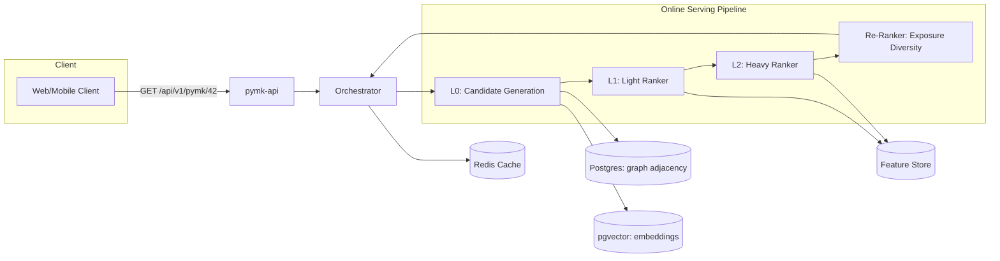

# People You May Know (PYMK)

A portfolio-scale reimplementation of LinkedIn-style **"People You May Know"**
recommendations, built on the Java/Spring ecosystem, following the
multi-stage funnel architecture described in LinkedIn Engineering's public
PYMK writeup: **candidate generation (L0) → light ranking (L1) → heavy
ranking (L2) → re-ranking (exposure diversity)**.

> 🚧 **Status: Day 29 of 30 complete.** The API supports L0 → L1 → L2 → re-ranking,
> with explicit opt-in and an L1-only default/rollback path.
> See [`docs/PYMK_ROADMAP.md`](docs/PYMK_ROADMAP.md) for the day-by-day
> build log and [`docs/PYMK_DESIGN.md`](docs/PYMK_DESIGN.md) for the full
> system design.

---

## Why this project

Most CRUD portfolio projects stop at "REST API + database." This one
demonstrates both sides of a modern recommendation system:

- **Traditional backend engineering:** JPA, REST, Redis caching, Spring
  Batch ETL jobs, multi-module architecture designed to split into
  microservices without a rewrite.
- **Applied ML engineering:** feature engineering, offline model training
  (logistic regression → GBDT → small NN), ONNX/PMML serving from Java,
  offline evaluation (Recall@k, AUC, Precision@k, calibration), and temporal
  replay against a naive baseline. These are offline results, not an A/B test.

## Target architecture

The diagram is the end-state funnel. At the current Day 29 checkpoint, the
domain, data generator, embeddings, initial API, and complete L0 candidate
pipeline, Redis caching, and learned L1 scoring are implemented and wired into
the public endpoint. Offline L2 training and the opt-in Java L2 scorer are
implemented, with frozen offline ranking/calibration evaluation and configurable
public L2 serving, normalized blending and employer exposure selection.
Offline blend-weight tuning remains Day 30.



Full architecture, data model, API design, and offline evaluation strategy:
[`docs/PYMK_DESIGN.md`](docs/PYMK_DESIGN.md).

## L0 → L1 → optional L2 and re-ranking pipeline is live

The application is runnable end to end. A recommendation request currently:

1. Fans out concurrently to the shared-profile, two/three-hop graph, and
   pgvector embedding candidate sources.
2. Removes the requester, existing connections, duplicates, and deleted IDs.
3. Merges source provenance with reciprocal-rank fusion.
4. Batch-loads materialized pair features and scores the union in one ONNX
   inference call, ordered by connection probability.
5. In explicit L2 mode, scores every L1 survivor with the heavy model and sorts by
   acceptance probability, then candidate ID. RERANK mode instead blends both
   heads and applies a request-size-specific employer exposure cap. L1 remains
   the default rollback mode.
6. Caches the full L0 union and either a reusable L1/L2 top-100 result or the
   entire RERANK scored pool before selection. Returns up to the requested 1–100
   results with reasons; RERANK also reports realized employer exposure.

`X-PYMK-Scorer` identifies the active score semantics. See the
[Day 28 serving/rollback runbook](docs/DAY28_PUBLIC_L2.md) for activation,
compatibility checks, versioned caches, failure behavior and latency evidence.
The [Day 29 blend/diversity runbook](docs/DAY29_BLEND_DIVERSITY.md) documents
`PYMK_SERVING_RANKER=RERANK`, normalized weight/cap configuration, underfilled
responses, scored-pool caching and rollback. Default blend weights are not tuned;
Bayesian validation-only weight search remains Day 30.

After completing the Quickstart below, request three recommendations with:

```bash
curl --fail --show-error 'http://localhost:8080/api/v1/pymk/42?limit=3'
```

Example response shape (candidate IDs and signal values depend on the generated
dataset size, while the schema and ordering contract are stable):

```json
{
  "memberId": 42,
  "recommendations": [
    {
      "candidateId": 981,
      "score": 0.87,
      "mutualConnectionCount": 12,
      "reasons": [
        "12 mutual connections",
        "Same company: Acme Corp"
      ]
    }
  ]
}
```

`score` is the L1 model's positive-class probability in `[0,1]`; the separate
`mutualConnectionCount` remains available for explanations. The
default seed still uses deterministic placeholders. Day 22 implements the
frozen profile TF-IDF/SVD transform and vector export. Day 23 implements coordinated
live vector/feature/model activation and rollback through explicit batch jobs,
not on startup. See the [release runbook](docs/DAY23_RELEASES.md) and isolated
end-to-end smoke script for a complete train-to-serving example.
See [the profile-embedding CLI instructions](pymk-ml-training/README.md#day-22-profile-embeddings)
for runnable fitting and frozen-transform export commands.
Authentication and abuse controls remain out of scope for this local portfolio
API, so it should not be exposed publicly as-is.

## Tech stack

| Layer | Choice |
|---|---|
| Language / Framework | Java 21, Spring Boot 3.5.x |
| Persistence | Spring Data JPA + PostgreSQL |
| Vector similarity | pgvector (embedding-based retrieval) |
| Caching | Spring Data Redis |
| Batch / ETL | Spring Batch |
| Graph traversal | Postgres recursive CTE |
| ML training | Python (scikit-learn/XGBoost/PyTorch) → ONNX/PMML |
| ML serving | ONNX Runtime Java / JPMML-Evaluator |
| Build | Maven multi-module |
| Testing | JUnit 5, Testcontainers, Mockito, Python `unittest`, ONNX Runtime parity checks |
| Local infra | Docker Compose (Postgres + pgvector, Redis) |

## Repository layout

```
pymk/
├── pymk-common/            # shared DTOs, enums, utils
├── pymk-domain/            # JPA entities, repositories
├── pymk-feature-store/     # feature computation + read/write API
├── pymk-candidate-gen/     # L0: graph, EBR, heuristic candidate sources
├── pymk-light-ranker/      # L1: logistic regression / GBDT scoring
├── pymk-heavy-ranker/      # L2: DNN model serving via ONNX Runtime
├── pymk-reranker/          # exposure diversity, Bayesian-tuned blending
├── pymk-orchestrator/      # wires stages together
├── pymk-api/               # public REST controllers (the runnable app)
├── pymk-batch/             # Spring Batch jobs
├── pymk-datagen/           # dev-tooling CLI: synthetic data generator (Day 4)
├── pymk-ml-training/       # Python project (offline), exports model artifacts
├── infra/                  # docker-compose.yml, init SQL
└── docs/                   # design doc + roadmap
```

`pymk-domain`, `pymk-api`, `pymk-datagen`, `pymk-candidate-gen`,
`pymk-orchestrator`, `pymk-feature-store`, `pymk-batch`, and
`pymk-ml-training`, `pymk-light-ranker`, and `pymk-heavy-ranker` have real content as of Day 26.
The remaining modules are intentionally
skeletal; see the roadmap for what fills in each module and when.

## Data model & how to seed the DB

Flyway migrations are the database schema source of truth; Hibernate validates
the entity mappings against them instead of creating or changing tables.

| Table | Purpose | Important invariant |
|---|---|---|
| `members` | Member profile and heuristic attributes | IDs come from the generator/upstream identity system; they are not database-generated |
| `connections` | First-degree graph adjacency | One undirected connection is stored as two directed rows; self-edges and duplicate directions are rejected |
| `member_events` | Timestamped profile, search, and invite activity | Actor and target must exist; generated invite lifecycles are temporally ordered |
| `member_embeddings` | One 128-dimensional pgvector embedding per member | Uses an HNSW cosine index; current vectors are random normalized placeholders |
| `pymk_features` | Directional member-candidate feature snapshots | Composite pair key, non-negative counts, bounded cosine similarity, and `feature_as_of <= computed_at` |
| `batch_*` | Spring Batch job/step execution and restart metadata | Flyway V4 owns the official PostgreSQL metadata schema; V5 indexes label lookups |

`ConnectionService` owns the two-row connection invariant and writes both
directions in one transaction. Application code should not create a single
`connections` row directly.

To create a local database and seed it from a clean checkout:

```bash
# Start Postgres; Redis is not required by the generator yet.
docker compose -f infra/docker-compose.yml up -d postgres

# Build the generator and the modules it depends on.
mvn -B -pl pymk-datagen -am package -DskipTests

# Fast local dataset (20,000 members).
java -jar pymk-datagen/target/pymk-datagen.jar --pymk.datagen.members=20000

# Omit the override for the default 100,000-member dataset.
# java -jar pymk-datagen/target/pymk-datagen.jar
```

The seed defaults to `42`, so profiles and graph topology are reproducible for
the same member count. Timestamps are relative to the run time. The generator
prints row counts, degree percentiles, popular organizations, and event counts
when it finishes. You can independently inspect the loaded tables with:

```bash
docker exec pymk-postgres psql -U pymk -d pymk -c "SELECT 'members' AS table_name, count(*) FROM members UNION ALL SELECT 'connections', count(*) FROM connections UNION ALL SELECT 'member_events', count(*) FROM member_events UNION ALL SELECT 'member_embeddings', count(*) FROM member_embeddings UNION ALL SELECT 'pymk_features', count(*) FROM pymk_features;"
```

> **Reset behavior:** seeding truncates the generated-data tables and any
> dependent `pymk_features` rows by default. This is controlled by
> `--pymk.datagen.truncate-existing=false`, but
> disabling truncation is not an append mode: generated IDs restart at `1` and
> will conflict with an existing generated dataset. PostgreSQL data persists in
> the `pymk_postgres_data` Docker volume; `docker compose -f
> infra/docker-compose.yml down -v` deliberately removes it.

All generator options and their defaults are documented in
[`pymk-datagen/README.md`](pymk-datagen/README.md).

## Quickstart

**Prerequisites:** JDK 21, Maven 3.9+, Docker.

```bash
# 1. Clone
git clone https://github.com/AhdyAhmed/People-You-May-Know-PYMK.git
cd People-You-May-Know-PYMK

# 2. Start Postgres (with pgvector) + Redis
docker compose -f infra/docker-compose.yml up -d

# 3. Build and install all modules (Docker is used by integration tests)
mvn -B install

# 4. Seed a synthetic dataset (~100K members by default; see pymk-datagen/README.md)
mvn -pl pymk-datagen spring-boot:run

# 5. Produce the feature snapshot and model artifacts using the workflow below
#    (the API intentionally fails fast if the configured model is absent/invalid)

# 6. Run the API
mvn -pl pymk-api spring-boot:run
```

Then:
```bash
curl http://localhost:8080/
# {"service":"pymk-api","status":"up","milestone":"M5 - Day 29: weighted blend and employer exposure selection","scorer":"L1"}

curl http://localhost:8080/api/v1/members/42      # a seeded member (Day 6, Part 1)
curl 'http://localhost:8080/api/v1/pymk/42?limit=20' # Day 11 recommendations
curl -X POST http://localhost:8080/api/v1/connections \
  -H 'Content-Type: application/json' \
  -d '{"memberId": 42, "connectedMemberId": 981}'   # Day 6, Part 2
# Browse to http://localhost:8080/swagger-ui.html for interactive API docs
```

Run the Day 17 feature materialization after seeding. `featureAsOf` is a
required ISO-8601 instant; the job records `computedAt` from its own UTC clock,
and `run.id` identifies an intentional rerun:

```powershell
$snapshot = [DateTime]::UtcNow.ToString("yyyy-MM-ddTHH:mm:ssZ")
$runId = [DateTimeOffset]::UtcNow.ToUnixTimeMilliseconds()
java -jar pymk-batch/target/pymk-batch.jar "featureAsOf=$snapshot" "run.id=$runId"
```

The job reads only snapshot-eligible members and bounded L0-style candidates,
uses non-regressing upserts in configurable chunks, and removes older snapshots
only after successful materialization. A failed run can be restarted with the
same parameters. Chunk commits can leave mixed old/new feature rows until the
refresh completes; affected uncached requests fail with retryable `503` rather
than mixing snapshots. Snapshots older
than the latest completed materialization are rejected.

After the outcome window for that snapshot has fully elapsed, export the Day 18
training dataset. `labelWindowEnd` must be later than the snapshot and no later
than the current time; `outputPath` may include directories that do not yet
exist:

```powershell
$snapshot = "2026-09-01T00:00:00Z"       # an existing feature snapshot
$labelEnd = "2026-09-08T00:00:00Z"       # a fully observed outcome cutoff
$runId = [DateTimeOffset]::UtcNow.ToUnixTimeMilliseconds()
$output = Join-Path (Get-Location) "artifacts/training/pymk-training.csv"
java -jar pymk-batch/target/pymk-batch.jar `
  --spring.batch.job.name=trainingDatasetExportJob `
  "featureAsOf=$snapshot" "labelWindowEnd=$labelEnd" `
  "outputPath=$output" "run.id=$runId"
```

The CSV is ordered by snapshot and directional pair. It includes all current
features, the 30-day observation boundary, the label boundary, and `label=1`
only for `INVITE_ACCEPTED` events in `(featureAsOf, labelWindowEnd]`. Export
uses a private staging file and replaces the final artifact only after all rows
are written successfully.

Train the Day 19 L1 model after collecting at least three exports with distinct
snapshots. Whole snapshots—not individual rows—are assigned chronologically to
train, validation, and test partitions. Label windows in each earlier partition
must have ended by the next partition's
first feature snapshot. Overlapping windows are rejected before training.
The example below assumes label horizons no longer than seven days; use wider
snapshot spacing for longer label windows.

```powershell
cd pymk-ml-training
python -m venv .venv
.venv\Scripts\python -m pip install -e .
.venv\Scripts\python -m pymk_training.train_light_ranker `
  --input ..\artifacts\training\snapshot-2026-08-01.csv `
  --input ..\artifacts\training\snapshot-2026-08-08.csv `
  --input ..\artifacts\training\snapshot-2026-08-15.csv `
  --output-dir ..\artifacts\models\light-ranker `
  --model-version light-logreg-v1
```

The command publishes `light-logreg-v1.onnx` and a matching metadata JSON only
after the ONNX graph passes validation and its probabilities match the fitted
scikit-learn pipeline. See
[`pymk-ml-training/README.md`](pymk-ml-training/README.md) for the complete
contract and verification command.

Model versions are immutable within the output directory: if either output file
already exists, training refuses that version. Use a new `--model-version` for
retraining and update both serving artifact paths and `pymk.cache.model-version`.
The two files publish individually, ONNX first; an interrupted pair is inactive
and a fresh training attempt must use a new version.

Day 20 consumes that pair of artifacts in `pymk-light-ranker`. The Java loader
verifies the metadata schema, feature order, tensor types/shapes, positive
class, and model checksum before creating a serving session. Its defaults are:

```yaml
pymk:
  light-ranker:
    model-path: artifacts/models/light-ranker/light-logreg-v1.onnx
    metadata-path: artifacts/models/light-ranker/light-logreg-v1.metadata.json
    max-candidates: 500
```

`L1LightRanker.rank` performs one feature-store query and one ONNX inference
for the entire L0 batch, rejects missing or mixed-snapshot features, and
preserves candidate provenance in its deterministic top-K result. Day 21 wires
that result into the public endpoint; missing features or model failures return
retryable `503` responses rather than partial recommendations.

## API (Day 6)

`GET /api/v1/members/{id}` accepts a positive member ID and returns a profile
and its first-degree connection count:

```json
{
  "id": 42,
  "fullName": "Ada Lovelace",
  "headline": "Senior Software Engineer",
  "company": "Acme Corp",
  "school": "MIT",
  "geoRegion": "Cairo",
  "connectionCount": 137,
  "createdAt": "2026-01-15T10:00:00Z"
}
```

`POST /api/v1/connections` stores both directions of the undirected graph edge;
event ingestion is a separate future endpoint. It returns
`201` with `created: true` for a new connection and `200` with `created: false` when
the pair is already connected. Validation and domain failures use RFC 9457
`application/problem+json` responses. The live OpenAPI document is available at
`/v3/api-docs`, with Swagger UI at `/swagger-ui.html`.

## Candidate generation (Days 8–10)

`pymk-candidate-gen` now defines the internal L0 `CandidateSource` contract.
Each `CandidateHit` includes a candidate ID, stable source type, source-local
score, and immutable explanation metadata rather than returning a bare ID.

`HeuristicCandidateSource` retrieves exact
company, school, and geographic-region matches. It sorts by the number of
matching available attributes and then member ID, making limits deterministic.

`GraphWalkCandidateSource` uses a cycle-safe recursive PostgreSQL CTE to find
shortest two/three-hop candidates and count equally short paths.
`EmbeddingRetrievalCandidateSource` uses pgvector cosine distance and exposes
cosine similarity as its source score. Both database queries remove direct
connections before applying their limit, preventing under-filled results.

All sources apply the shared eligibility policy, which removes the requesting
member, current connections, duplicates, and IDs that no longer exist.
`L0CandidateGenerator` executes them on Java 21 virtual threads with a
configurable concurrency bound, enforces per-source budgets and a global cap,
then merges duplicate IDs without losing any source hit. Reciprocal-rank fusion
provides deterministic union ordering without pretending heterogeneous source
scores are calibrated. Source failures cancel the remaining work instead of
silently serving incomplete results.

Default L0 controls can be overridden with Spring configuration:

```yaml
pymk:
  candidate-generation:
    global-limit: 3000
    max-concurrency: 3
    source-limits:
      HEURISTIC: 1000
      GRAPH_WALK: 2000
      EMBEDDING: 1000
```

## Recommendation endpoint (Days 11–21)

`GET /api/v1/pymk/{memberId}?limit=20` serves the complete L0 pipeline through
`pymk-orchestrator`. The limit defaults to 20 and must be between 1 and 100.
Day 21 passes the L0 union to the batched light ranker. Results are ordered by
the learned positive-class probability, then L0 fusion score and candidate ID
for deterministic ties. `score` is that probability; mutual count remains a
separate response field and explanation signal.

These class-weighted model outputs have not yet been validated as calibrated
acceptance rates. Day 27 reports raw calibration diagnostics; it does not fit a calibrator.

The milestone section above contains the public request and response example.

Self, existing connections, missing members, and duplicate candidates remain
excluded. Unknown requesters return `404`, invalid IDs or limits return `400`,
and candidate, feature-store, or model serving failures return retryable `503`.
New graph candidates may lack materialized features until the next successful
batch refresh; the endpoint requires complete, consistent feature coverage.

## Redis caching (Day 12)

The orchestrator caches both the full L0 candidate union and the final top-100
L1- or L2-ranked result. A request for any limit from 1 to 100 slices the same final
entry, avoiding one cache key per limit. Every key contains schema, pipeline,
and model versions so a deployment can move to a new namespace without reading
incompatible payloads. Day 28 also derives a scorer identity from mode/semantics,
survivor budget and heavy model/metadata content, and pins a database source
revision in the key. Managed releases retain their release ID and activation epoch.

RERANK uses a separate pre-selection scored-pool cache containing every L1
survivor, including employer groups. Each request reapplies its own limit's cap;
do not cache one diversified page and slice it for other limits. Its derived
identity also includes normalized weights and employer-cap policy. Profile and
connection mutations advance the source revision, fencing old groups/eligibility.

The configured `model-version` must match the legacy L1 artifact's metadata;
managed releases instead validate against the pinned database model version before
either cache layer can be read. L2 also checks release compatibility on warm hits;
a mismatch returns `503`. Publish new model
bytes with a new version and update this configuration together. Null JSON,
wrong-member responses, self/duplicate candidates, oversized final lists, and
unordered final scores are evicted and recomputed. Managed feature refreshes must
publish a new release, which changes the namespace. Direct legacy feature-table
refreshes still require explicit eviction/versioning or expiry; direct edits to
immutable managed features are unsupported.

Defaults can be overridden with Spring configuration:

```yaml
pymk:
  cache:
    enabled: true
    key-prefix: pymk
    schema-version: v1
    pipeline-version: l0-l1-v1
    model-version: light-logreg-v1
    l0-ttl: 30m
    result-ttl: 15m
```

After a connection is committed, both cache layers are invalidated for the two
members and their two-hop neighborhoods. Redis connection, serialization, or
payload failures fall back to the database-backed pipeline; they do not turn a
recommendation request into an error.

## Recommendation QA (Day 13)

The automated end-to-end quality gate checks several synthetic requester IDs
and limits from 1 to 100 against real PostgreSQL/pgvector and Redis containers.
It rejects self-recommendations, existing connections, duplicates, missing
members, over-limit responses, unstable cached ordering, and regressions in the
L1 probability ordering or explanation reasons.

For a running application seeded with your own data, inspect several IDs with:

```powershell
.\scripts\day13-recommendation-smoke.ps1 -MemberId 42,314,2718 -Limit 20
```

The script fails on response-visible invariant violations and prints candidate
scores, mutual counts, and reasons for relevance review. Existing-connection
exclusion is verified by the database-backed automated test because the public
API intentionally does not expose a member's adjacency list.

## Tests

```bash
mvn -B verify
```

Repository and integration tests run against real Postgres/pgvector and Redis
instances started by [Testcontainers](https://testcontainers.com/), so **Docker must be
running**, but you do *not* need `docker compose up` for the test suite. Tests
also run `spring.jpa.hibernate.ddl-auto=validate`, so a mismatch between the
JPA entities and the Flyway migrations fails the build.

To stop the local infra: `docker compose -f infra/docker-compose.yml down`
(add `-v` to also wipe the Postgres/Redis volumes).

## Build log

This project is being built in public, one focused session at a time. Each
day's scope and status lives in [`docs/PYMK_ROADMAP.md`](docs/PYMK_ROADMAP.md).

- [x] **Day 1 — Repo & environment setup**: multi-module Maven skeleton (11
      modules), Docker Compose (Postgres + pgvector, Redis), CI build.
- [x] **Day 2 — Core JPA entities**: `Member`, `Connection`, `MemberEvent` (+
      `EventType`) in `pymk-domain`, with a Flyway migration for the schema
      (indexes on `connections`, `member_events`, and the heuristic-source
      lookup columns on `members`).
- [x] **Day 3 — Repositories & basic queries**: Spring Data repositories for
      the three entities, a `ConnectionService` that owns the "one connection =
      two rows" invariant, and Testcontainers tests proving symmetric inserts,
      DB-level constraints, and index-backed adjacency lookups on a 5,000-member
      / ~50K-edge graph.
- [x] **Day 4 — Synthetic data generator**: `pymk-datagen` — Datafaker
      members with a Zipf-weighted company/school/geo pool, a
      Barabási–Albert preferential-attachment connection graph, and
      timeline-consistent invite/profile-view/search events, bulk-loaded via
      chunked JDBC batches with a post-load summary report. Defaults to
      100,000 members.
- [x] **Day 5 — pgvector + embeddings table**: `member_embeddings`
      (Hibernate's native `hibernate-vector` module maps `float[]` to
      pgvector's `vector(128)`), an HNSW cosine-distance index, ANN search
      via `EmbeddingSearchRepository`, placeholder random vectors from
      `pymk-datagen`, and a test proving the ANN query returns
      semantically-sensible neighbors on constructed clusters.
- [x] **Day 6 — `pymk-api` skeleton** *(built in 3 parts)*
  - [x] Part 1 — springdoc OpenAPI + Swagger UI, `GET /api/v1/members/{id}`,
        RFC 9457 `ProblemDetail` error handling, MockMvc + Testcontainers tests.
  - [x] Part 2 — `POST /api/v1/connections`: Bean Validation, idempotent
        (201 created / 200 already connected), 400 self-connect, 404 unknown
        member, 409 on the unique-constraint race.
  - [x] Part 3 — polish: status endpoint, README API section, end-to-end test.
- [x] **Day 7 — Buffer / catch-up + write-up**: audited the completed M1
      foundation, synchronized the live milestone and planning documents, and
      added the data-model and database-seeding runbook.
- [x] **Day 8 — Candidate source contract + heuristic retrieval**:
      provenance-preserving `CandidateHit`, deterministic company/school/geo
      retrieval, shared eligibility filtering, and database-backed tests.
- [x] **Day 9 — Graph-walk + embedding retrieval**: cycle-safe two/three-hop
      recursive traversal, pgvector cosine retrieval, source scoring, pre-limit
      connection exclusion, and deterministic integration fixtures.
- [x] **Day 10 — Parallel L0 union**: bounded virtual-thread fan-out,
      configurable source budgets/global cap, provenance-preserving
      de-duplication, reciprocal-rank fusion, cancellation, and unit tests.
- [x] **Day 11 — Naive orchestrator + endpoint**: bulk mutual-connection
      enrichment, deterministic baseline ranking, bounded public results,
      explanation reasons, OpenAPI documentation, and end-to-end tests.
- [x] **Day 12 — Redis caching**: versioned L0/final keys, configurable TTLs,
      stable JSON payloads, graceful fallback, post-commit neighborhood
      invalidation, and real-Redis integration tests.
- [x] **Day 13 — Recommendation QA**: multi-member end-to-end relevance checks,
      automated safety invariants across boundary limits, cached determinism,
      explanation validation, and a reusable live-data smoke script.
- [x] **Day 14 — M2 release documentation**: declared the naive v1 pipeline
      live, documented its complete request path, added a runnable request and
      response example, and stated the current baseline limitations explicitly.
- [x] **Day 15 — Feature-store schema + composite key**: Flyway V3,
      directional `PairId`, `PymkPairFeature`, Spring Data persistence,
      leakage-safe `featureAsOf` plus audit `computedAt`, database constraints,
      reset-path compatibility, and real-PostgreSQL integration tests.
- [x] **Day 16 — Feature computation**: snapshot-bounded mutual connections,
      exact nonblank profile matches, pgvector-backed cosine similarity,
      directional 30-day profile-view counts, future-signal exclusion, pure
      calculator tests, and real-PostgreSQL/pgvector integration coverage.
- [x] **Day 17 — Spring Batch feature materialization**: runnable batch app,
      Flyway-managed restart metadata, snapshot-safe bounded candidate input,
      chunked feature upserts, post-success stale-snapshot cleanup, validated
      job parameters, and repeat-run PostgreSQL/pgvector integration coverage.
- [x] **Day 18 — Leakage-safe training export**: mature observation/label
      windows, directional acceptance labels, deterministic CSV ordering,
      restartable chunk processing, atomic publication, parameter validation,
      and repeat-run PostgreSQL integration coverage.
- [x] **Day 19 — L1 model training**: strict multi-snapshot CSV validation,
      whole-snapshot chronological splits, scaled class-balanced logistic
      regression, ONNX export/runtime parity verification, atomic artifacts,
      audit metadata, Python tests, and CI coverage.
- [x] **Day 20 — L1 model serving**: ONNX Runtime Java loading, strict artifact
      and tensor-contract checks, batched feature lookup/inference,
      deterministic configurable top-K ranking, fail-closed snapshot coverage,
      and real cross-language model execution tests.
- [x] **Day 21 — Public L1 cutover**: L0 → L1 orchestration, probability scores,
      feature-row explanation reuse, versioned cache namespace migration,
      retryable ranker failures, before/after ordering checks, and full API
      integration coverage with materialized features.
- [x] **Day 22 — Profile embeddings**: frozen, cutoff-safe TF-IDF/SVD transforms,
      normalized 128-dimensional staging exports, provenance migration, neutral
      blank-vector retrieval, and shared Python/pgvector semantic-neighbor tests.
- [x] **Day 23 — Coordinated serving releases**: restartable embedding/feature
      staging, compatible training exports and ONNX validation, atomic activation,
      request-pinned database/model/cache versions, durable models and rollback.
- [x] **Day 24 — Multi-target data v2**: release-bound invitation-sent/accepted
      labels, immutable dataset registry and CSV/provenance, late-correction
      identities, strict Python validation and leakage-safe temporal partitions.
      See the [v2 export runbook](docs/DAY24_DATASETS.md). The live API remains L0 → L1.
- [x] **Day 25 — Offline heavy model**: seeded two-head PyTorch training,
      train-only preprocessing, validation-selected checkpoint, named ONNX
      outputs/parity and immutable artifacts with frozen-baseline comparisons.
      See the [training runbook](docs/DAY25_HEAVY_TRAINING.md). No L2 serving cutover yet.
- [x] **Day 26 — Java heavy scorer**: real batched ONNX inference with both named
      probability heads, release/feature compatibility checks, Python parity and
      safe resource cleanup. See the [serving runbook](docs/DAY26_HEAVY_SERVING.md).
      Public HTTP scoring remains L1 until Day 28.
- [x] **Day 27 — Frozen offline evaluation**: both L2 heads, raw L1 and mutual-count
      comparisons; AUC, query-grouped Precision/Recall@k, ECE/Brier, requester
      bootstrap intervals and a fixed quality gate. Historical cohorts/stage losses
      require checked replay context; missing evidence is explicit, never inferred.
      See the [evaluation runbook](docs/DAY27_EVALUATION.md). No automatic promotion.
- [x] **Day 28 — Public L2 integration**: opt-in L0/L1/L2 serving, acceptance-head
      ordering, safe L1 rollback, content/revision-isolated caches, complete-or-503
      handling, real HTTP tests and cold/warm timing evidence. See the
      [public L2 runbook](docs/DAY28_PUBLIC_L2.md). No automatic model promotion.
- [x] **Day 29 — Blend and exposure selection**: opt-in RERANK mode, validated
      normalized weights, deterministic employer caps, full pre-selection pool
      caching, request-specific exposure reports, and real HTTP regression tests.
      See the [blend/diversity runbook](docs/DAY29_BLEND_DIVERSITY.md).
- [ ] ... see the roadmap for the full plan through M9, including the post-Day-30 Kafka event backbone.

## License

[MIT](LICENSE)

## Attribution

Architecture pattern (multi-stage funnel: L0 candidate generation → L1 light
ranking → L2 heavy ranking → re-ranking) adapted from LinkedIn Engineering's
public writeup on the "People You May Know" recommendation system. This is an
original implementation at portfolio scale, not a reproduction of LinkedIn's
internal system or text.
