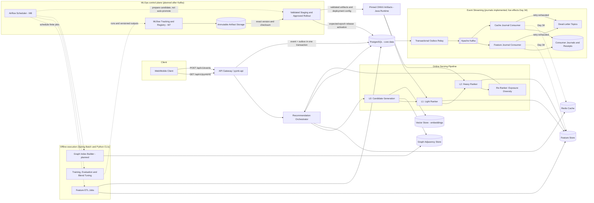
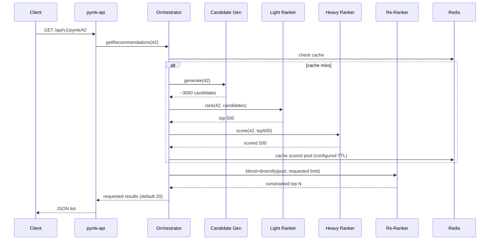

# People You May Know (PYMK) — Backend System Design

A portfolio-scale reimplementation of LinkedIn-style "People You May Know" recommendations, built on the Java ecosystem (Spring Boot, Spring Data JPA), following the multi-stage funnel architecture described in LinkedIn's PYMK engineering blog.

---

## 1. Goals & Scope

**Functional goals**
- Given a member, recommend a ranked list of other members they are likely to connect with.
- Support explicit signals (mutual connections, shared company/school, location) and implicit signals (profile views, search appearances).
- Capture member activity through a durable Kafka event backbone so fresh behavioral signals can update feature projections without coupling request handling to downstream consumers.
- Provide an exposure-diversity pass so results are not dominated by a single cluster (e.g. all coworkers), while avoiding unsupported claims of protected-attribute fairness.
- Serve recommendations with low latency (<150ms p99 target for demo scale).

**Non-functional / portfolio goals**
- Demonstrate a realistic **multi-stage ranking pipeline** (candidate generation → light ranking → heavy ranking → re-ranking), scaled down from "billions of members" to a dataset of ~100K–1M synthetic members, so it runs on a laptop / a single cheap cloud VM but the architecture generalizes.
- Clean separation of concerns so each stage could later be extracted into its own microservice.
- Show both the "traditional Spring backend" skills (JPA, REST, caching, batch jobs) and applied ML engineering (feature engineering, model training/serving, offline evaluation).
- After Kafka, add reproducible experiment/model lifecycle management with MLflow, then bounded workflow orchestration with Airflow. Both remain operational control-plane services, outside recommendation requests.

**Out of scope (documented, not built)**
- True graph-database-scale traversal (v1 uses a graph adjacency table in Postgres; Neo4j or adjacency shards are upgrade paths, not current modules).
- Authentication, authorization, and abuse controls. The portfolio API is local/demo infrastructure and must not be exposed publicly without them.

### 1.1 Document status and implementation boundary

This document is the **target design**, not a claim that every box already
exists. The roadmap is the delivery authority when design and implementation
status differ.

| Area | Current status |
|---|---|
| Maven modules, Postgres/pgvector/Redis local infrastructure | Implemented through Day 1 |
| Core entities, Flyway schema, repositories, symmetric connection service | Implemented through Day 3 |
| Synthetic members, graph, temporally valid events, placeholder embeddings | Implemented through Day 5 |
| Member lookup, connection creation, Problem Details, OpenAPI, smoke status | Implemented through Day 6 |
| Foundation audit and documented data-model/seeding runbook | Implemented on Day 7 |
| Candidate contract, heuristic source, shared eligibility policy | Implemented on Day 8 |
| Cycle-safe graph-walk and pgvector embedding candidate sources | Implemented on Day 9 |
| Bounded parallel L0 union, provenance merge, budgets/global cap | Implemented on Day 10 |
| Naive mutual-connection orchestrator and public PYMK endpoint | Implemented on Day 11 |
| Versioned L0/final Redis caches and graph-mutation invalidation | Implemented on Day 12 |
| End-to-end recommendation relevance and safety QA | Implemented on Day 13 |
| M2 naive-v1 release contract and runnable documentation | Completed on Day 14 |
| Directional pair-feature schema, entity, repository, and snapshot contract | Implemented on Day 15 |
| Snapshot-safe pair-feature computation | Implemented on Day 16 |
| Restartable Spring Batch feature materialization | Implemented on Day 17 |
| Leakage-safe labeled training-data export | Implemented on Day 18 |
| Chronological L1 logistic-regression training and ONNX export | Implemented on Day 19 |
| Batched, contract-validated ONNX L1 serving | Implemented on Day 20 |
| Public L0 → L1 orchestration and model-versioned caching | Implemented on Day 21 |
| Frozen profile TF-IDF/SVD embeddings, staging export and vector provenance | Implemented on Day 22 |
| Coordinated vector/feature/model releases, request pinning and rollback | Implemented on Day 23; see `DAY23_RELEASES.md` |
| Versioned multi-target exports, immutable dataset lineage and chronological validation | Implemented on Day 24; see `DAY24_DATASETS.md` |
| Offline PyTorch two-head training, ONNX export and frozen-cohort comparisons | Implemented on Day 25; see `DAY25_HEAVY_TRAINING.md` |
| Batched, release-compatible Java heavy scorer with two named probability heads | Implemented on Day 26; see `DAY26_HEAVY_SERVING.md` |
| Frozen ONNX evaluation, raw calibration diagnostics, requester bootstrap and replay-context subgroup/stage analysis | Implemented on Day 27; see `DAY27_EVALUATION.md` |
| Configurable public L2 serving, L1 rollback, content/revision cache isolation and stage timers | Implemented on Day 28; see `DAY28_PUBLIC_L2.md` |
| Configured two-head blending and deterministic employer exposure selection | Implemented on Day 29; see `DAY29_BLEND_DIVERSITY.md` |
| Validation-only Bayesian blend search and immutable deployable configuration | Implemented on Day 30; see `DAY30_BLEND_TUNING.md` |
| Kafka development infrastructure, frozen v1 contracts and routing/identity validation | Implemented Day 31; see `DAY31_KAFKA_CONTRACTS.md` |
| Durable event ingestion, transactional outbox and acknowledged Kafka publishing | Implemented Day 32; see `DAY32_EVENT_OUTBOX.md` |
| Independent journal consumers, durable deduplication, bounded retries and DLT replay | Implemented Day 33; see `DAY33_EVENT_CONSUMERS.md` |
| Live streaming feature/cache projections and resilience telemetry | Planned for Days 34–35 (M6) |
| MLflow experiment tracking, model registry and guarded release preparation | Planned for Days 36–40 (M7); section 7.3 |
| Airflow scheduling, safe backfills and restartable batch/ML workflows | Planned for Days 41–45 (M8); section 7.4 |
| Unified operational dashboards and packaged portfolio release | Planned for M9–M10 |

The current checkpoint is **Day 33 complete (M1–M5 complete; M6 in progress)**. Target-only sections below use
future tense where practical; see `PYMK_ROADMAP.md` for acceptance criteria.

### 1.2 Delivery and acceptance rules

The runnable checkpoint is the public L0 → L1 pipeline with explicit optional L2 and re-ranking, plus offline profile
embedding generation with coordinated live release activation and offline multi-target
datasets plus offline heavy-model training, an opt-in Java L2 scorer and frozen
offline evaluation and safe process-level L1/L2 rollback. Day 30 adds reproducible offline weight tuning;
Days 31–35 add Kafka, Days 36–40 add MLflow, and Days 41–45 add Airflow and batch
operations. M9–M10 cover observability and release packaging. These are acceptance
sequences, not promised calendar durations. Each milestone must leave a reproducible
demo, checked artifact contracts, automated failure cases, and a rollback path.
The 150 ms p99 figure is a target, measured separately for cache hits and misses
at a stated dataset size, concurrency, hardware, and request mix; it is not a
current performance guarantee. Start with the documented 50K–100K synthetic
dataset and increase scale only after measurement.

Planned acceptance criteria below apply when their owning day is implemented.
They do not mark future modules or operational guarantees as already delivered.

### 1.3 Delivery dependencies and release gates

| Owner | Deliverable | Gate before it can affect serving |
|---|---|---|
| Days 19–22, implemented | Frozen L1 model and profile transform artifacts | Validate schema/checksums, reject an existing output version, verify actual inference and vector contracts |
| Day 23 | Embedding generation plus compatible features and L1 release | Complete staged coverage, evaluate/retrain L1 on matching vectors, publish one coherent release and prove rollback |
| Days 24–28 | Multi-target labels, L2 training/evaluation/serving | Same frozen evaluation cohort, Java/ONNX parity, explicit score semantics, selectable L1 rollback |
| Days 29–30 | Blend and diversity policy | Valid weights, request-size-specific cap tests, validation-only tuning, untouched test report |
| Days 31–35 | Kafka ingestion and projections | Durable database receipt, replay-safe effects, tested late events and recovery without changing historical snapshots |
| Days 36–40 (M7) | MLflow tracking, registry and model synchronization | Reproducible lineage, verified immutable artifacts, approval-bound manifest and tested rollback; no live registry lookup |
| Days 41–45 (M8) | Airflow scheduling and batch operations | Stable job identities, mature labels, safe backfills and retries, fenced activation and scheduler-outage isolation |
| M9–M10 | Observability and packaged demo | Prove outage/load/restore behavior across the expanded stack and reproduce lightweight/full-profile startup |

An offline export is not an active serving release. Feature shape compatibility
does not establish statistical compatibility: changing embeddings changes L0
candidates and the cosine distribution seen by L1. Day 23 therefore includes
the minimum coordinated feature/model release mechanism; M7 adds experiment and
registry lineage, while M8 expands scheduling, reconciliation and operations
rather than postponing that correctness requirement.
Each future gate records its dataset, commands, artifact hashes and observed
results. If a quality gate fails, retain the compatible previous release and
record the failure; elapsed calendar days do not override acceptance criteria.

---

## 2. High-Level Architecture



Ranking stages run in-process behind Java interfaces at the Day 33 checkpoint;
L2 and re-ranking are opt-in. Dashed edges denote planned live effects or
orchestration/tracking, not request-time dependencies. Ingestion/outbox publishing
and independent durable journal consumers are implemented. Live feature/cache
effects remain Day 34; MLOps remains future work. The current manual artifact/release
workflow remains usable without those additions.
MLflow aliases never replace the PostgreSQL release pointer, and Airflow schedules
finite jobs rather than running continuous Kafka consumers. Section 7.3 defines
the separate deployment boundary for process-level L2/blend configuration.

A later service extraction can replace an implementation
with REST/gRPC without changing the orchestrator's domain contract. Module
boundaries are architectural seams, not a requirement to deploy every module as
a separate microservice.

---

## 3. Tech Stack

| Layer | Choice | Notes |
|---|---|---|
| Language / Framework | Java 21, Spring Boot 3.x | LTS Java, virtual threads for I/O-bound fan-out calls |
| Persistence | Spring Data JPA + PostgreSQL | Core member/connection/event data |
| Caching | Spring Data Redis | Cache L0 candidate sets and final PYMK lists (TTL) |
| Batch / ETL | Spring Batch | Implemented restartable jobs; automatic schedules arrive in M8 |
| Async / messaging (M6 in progress) | Apache Kafka 3.9.1 + Spring Kafka | Ingestion/outbox, journal consumers and DLT recovery implemented through Day 33; live effects/telemetry remain Days 34–35 |
| Experiment/model lifecycle (planned M7) | MLflow Tracking + Model Registry | PostgreSQL metadata, persistent artifact storage, exact model versions and auditable release preparation |
| Workflow orchestration (planned M8) | Apache Airflow | Schedules existing Spring Batch/Python jobs; independent metadata and bounded worker resources |
| Graph traversal | Postgres recursive CTE (v1) → Neo4j (v2, optional module) | n-hop neighbor candidate generation |
| Vector similarity | pgvector extension on Postgres | Embedding-based retrieval (EBR) candidate source |
| ML training / serving | Python scikit-learn for L1; PyTorch for L2; ONNX Runtime Java for serving | Implemented through Day 30; L1 remains the default, with explicit L2/re-ranking opt-in |
| API | Spring Web (REST), OpenAPI/Swagger | `pymk-api` module |
| Testing | JUnit5, Testcontainers (Postgres/Redis), Mockito | |
| Build | Maven multi-module | One parent reactor, Java 21 toolchain |
| Deployment | Docker Compose (local), optional Kubernetes manifests | |
| Observability (planned M9) | Micrometer + Prometheus + Grafana | Unified serving, Kafka, MLflow and Airflow dashboards; current actuator health/stage timers are separate |

---

## 4. Repository / Module Layout

```
pymk/
├── pymk-common/            # shared DTOs, enums, utils
├── pymk-domain/             # JPA entities, repositories
├── pymk-feature-store/      # feature computation + read/write API
├── pymk-candidate-gen/      # L0: graph, EBR, heuristic candidate sources
├── pymk-light-ranker/       # L1: logistic regression / GBDT scoring
├── pymk-heavy-ranker/       # L2: DNN model serving via ONNX Runtime
├── pymk-reranker/           # exposure diversity, Bayesian-optimized blending
├── pymk-orchestrator/       # wires stages together, exposes internal service API
├── pymk-api/                # public REST controllers, request/response DTOs
├── pymk-batch/               # Spring Batch jobs: ETL, model refresh, graph index build
├── pymk-event-stream/        # frozen contracts, source/DLT topology and replay; API owns ingress/outbox/consumer transactions
├── pymk-datagen/             # one-off synthetic dataset generator for local development
├── pymk-ml-training/         # Python CLIs and artifacts; MLflow adapters planned M7
├── orchestration/airflow/    # thin DAGs, job adapters and tests (planned M8; not a Maven module)
├── infra/                    # Compose/init SQL; optional MLflow/Airflow profiles planned M7/M8
└── docs/
    └── PYMK_DESIGN.md (this file)
```

---

## 5. Data Model (Spring Data JPA)

### 5.1 Implemented and planned entities

`Member`, `Connection`, `MemberEvent`, `MemberEmbedding`, and
`PymkPairFeature` are implemented.

```java
@Entity
@Table(name = "members")
public class Member {
    @Id
    private Long id;
    private String fullName;
    private String headline;
    private String company;
    private String school;
    private String geoRegion;
    private Instant createdAt;
    // profile completeness, industry, etc.
}

@Entity
@Table(name = "connections", indexes = {
    @Index(name = "idx_conn_member", columnList = "member_id"),
    @Index(name = "idx_conn_connected", columnList = "connected_member_id")
})
public class Connection {
    @Id @GeneratedValue
    private Long id;
    private Long memberId;
    private Long connectedMemberId;
    private Instant connectedAt;
    // undirected edge, stored as two directed rows for indexed adjacency lookups
}

@Entity
@Table(name = "member_events")
public class MemberEvent {
    @Id @GeneratedValue
    private Long id;
    private Long actorMemberId;
    private Long targetMemberId;
    @Enumerated(EnumType.STRING)
    private EventType type; // PROFILE_VIEW, SEARCH_APPEARANCE, INVITE_SENT, INVITE_ACCEPTED, INVITE_IGNORED
    private Instant occurredAt;
}

@Entity
@Table(name = "member_embeddings")
public class MemberEmbedding {
    @Id
    private Long memberId;
    @Column(columnDefinition = "vector(128)") // pgvector
    private float[] embedding;
    private Instant updatedAt;
    private String embeddingVersion; // immutable transform label, V6
    private Instant fitCutoff; // nullable only for legacy placeholder vectors
}

@Entity
@Table(name = "pymk_features")
public class PymkPairFeature {
    @EmbeddedId
    private PairId id; // (memberId, candidateId)
    private int mutualConnectionCount;
    private boolean sameCompany;
    private boolean sameSchool;
    private boolean sameGeo;
    private double embeddingCosineSim;
    private int profileViewCountLast30d;
    private Instant featureAsOf; // latest source data included; leakage boundary
    private Instant computedAt;
}
```

### 5.2 Schema notes
- `connections` is denormalized as a symmetric edge list with indexed adjacency lookup. Returning neighbors still scales with member degree; an index does not make a full adjacency read constant-time.
- `member_embeddings` uses **pgvector** so L0's embedding-based retrieval (EBR) source can do an ANN (`<=>` cosine distance) query directly in Postgres without a separate vector DB for portfolio scale. Documented upgrade path: Qdrant/Milvus for production scale.
- `pymk_features` is the legacy **feature store** table; managed generations use `pymk_release_features`. The active serving view supplies materialized member-candidate features to L1 and the opt-in L2 component. Refresh remains a manually launched Spring Batch job; nightly scheduling is planned.

### 5.3 Data invariants

- A connection is one logical undirected edge stored as `(A,B)` and `(B,A)` in one transaction. The database enforces foreign keys, no self-edge, and uniqueness per direction; `ConnectionService` owns the two-row invariant.
- Connection writes use canonical member order internally so simultaneous `(A,B)` and `(B,A)` requests acquire keys consistently rather than deadlocking.
- API connection creation is idempotent: new edges return `201`, complete existing edges return `200`, and a unique-constraint race returns retryable `409`.
- Synthetic connections and events never predate either involved member and never occur after the generator's reference time.
- Embedding retrieval uses cosine distance (`<=>`) with the matching `vector_cosine_ops` HNSW index. `<->` is Euclidean distance and is not interchangeable at the query/index level.
- `pymk_features` keys are directional because member-to-candidate activity can differ from candidate-to-member activity. Both IDs must exist and differ.
- `feature_as_of` is the latest source-data time included in a row; `computed_at` is when it was materialized. The database enforces `feature_as_of <= computed_at` so feature snapshots cannot claim future knowledge.
- Day 16 feature computation counts mutual edges only when both directed edges existed by `feature_as_of`, and counts requester-to-candidate profile views in `(feature_as_of - 30 days, feature_as_of]`. Reverse views, the exclusive lower boundary, and later events are excluded.
- Embeddings are used only when both `updated_at` values are no later than the snapshot; otherwise cosine similarity is the neutral value `0`. Zero vectors also map to `0`, while malformed/non-finite vectors fail fast.
- Company, school, and geo flags require the same nonblank canonical value. The current synthetic model treats these member attributes as stable; historical profile-version storage is required before mutable production profiles can be backfilled without leakage.

Historical guarantees through Day 24 assume the synthetic source rows are stable.
`occurredAt` says when an event happened, not when the system learned about it.
M6/M8 replay must also retain `ingestedAt`/source revisions and declare whether a
dataset reconstructs knowledge available then or later corrected event history.
Late events may repair live projections, but cannot silently revise an archived
training dataset. Corrected datasets receive new identities and new evaluation
results. Mutable profiles require versioned observations before historical reuse.

---

## 6. The Multi-Stage Ranking Pipeline

This mirrors the LinkedIn blog's four stages directly.

### Stage L0 — Candidate Generation
**Goal:** reduce full member pool (v1 scale: up to 1M) down to a few thousand candidates. Optimize for **Recall@k**, not precision.

The `CandidateSource` contract, all three source implementations, and their L0
union are complete as of Day 10. Sources return provenance rather than bare IDs
so L1 calibration, debugging, and the explanation endpoint can distinguish why
a member entered the funnel:

```java
public record CandidateHit(
        long candidateId,
        CandidateSourceType source,
        double sourceScore,
        Map<String, String> metadata) {}

public interface CandidateSource {
    CandidateSourceType type();
    List<CandidateHit> generate(long memberId, int limit);
}
```

- `GraphWalkCandidateSource` — **implemented**; a recursive CTE fetches shortest simple 2/3-hop paths, prevents path cycles, counts equally short paths, and prioritizes closer candidates with more paths.
- `EmbeddingRetrievalCandidateSource` — **implemented**; pgvector cosine retrieval against `member_embeddings`, with cosine similarity as its source-local score.
- `HeuristicCandidateSource` — **implemented**; exact company/school/geo matches, scored by the fraction of the requester's available profile attributes that match. Results are ordered by match strength and then member ID for deterministic limits.

Every source applies the shared eligibility policy, which excludes the requesting
member, existing first-degree connections, duplicate hits within that source,
and member IDs that no longer exist. `L0CandidateGenerator` runs sources on
virtual threads behind a configurable concurrency semaphore, enforces source
budgets even if a source violates its contract, and caps the default union at
3,000 candidates. It de-duplicates across sources while retaining every source
hit and orders the union with reciprocal-rank fusion rather than comparing
uncalibrated source scores. A source failure cancels the remaining fan-out and
fails the generation request; partial candidate sets are not silently served.

### Day 11 baseline orchestration (superseded on Day 21)

`RecommendationOrchestrator` is the first end-to-end serving implementation.
It checks that the requester exists, generates the complete L0 union, fetches
mutual-connection counts for all candidates in one query, and orders by mutual
count descending. Day 10's fusion score and candidate ID provide deterministic
tie-breakers. The public limit defaults to 20 and is capped at 100. Candidate
source failures become retryable `503` Problem Details instead of an empty or
partially generated list. This mutual-count value was the temporary public
`score`; Day 21 replaced it with the L1 positive-class probability.

### Stage L1 — Light Ranker
**Goal:** narrow a few thousand candidates to a few hundred. Calibrate scores across the heterogeneous L0 sources so they're comparable. Evaluated by **Recall@k** at k≈500.

- **Implemented on Day 19:** a class-balanced logistic regression consumes the Day 18 feature/label contract after standard scaling. Whole `feature_as_of` snapshots are assigned chronologically to train, validation, and test partitions; random row splitting is prohibited.
- The trainer exports an ONNX opset-17 graph and metadata with the exact six-feature order, scaler values, coefficients, split boundaries, input/model hashes, metrics, and runtime versions. It executes the exported graph and compares probabilities with scikit-learn before publishing artifacts atomically.
- **Implemented on Day 20:** `pymk-light-ranker` loads the versioned artifact once with ONNX Runtime Java and validates its SHA-256 plus metadata, feature order, input shape/type, and two-class probability output before accepting traffic. It batch-fetches all directional feature rows and scores the full request in one inference call.
- `L1LightRanker` fails closed if a candidate is missing features, a batch mixes snapshots, or inference violates the output contract. It preserves L0 provenance and returns at most 500 candidates (configurable), ordered by positive-class probability with fusion score and candidate ID as deterministic tie-breakers.
- **Implemented on Day 21:** the public orchestrator composes cached L0 → L1 and publishes the positive-class probability as `score`. Mutual counts flow from the same feature rows into explanations, avoiding a second ranking query. L1 or feature-store failures on cache misses return the existing retryable `503` contract without caching a failed or partial response. Redis keys use explicit L0/L1 pipeline and model versions.
- **Day 21 hardening:** before reading either cache layer, the orchestrator checks that the configured cache model version matches the loaded model; mismatches return the same `503` contract. Invalid probabilities from any model implementation also use that serving contract. A full HTTP integration test exercises an actual exported ONNX model with PostgreSQL and Redis.
- Public scores are positive-class outputs from a class-weighted classifier, not measured acceptance rates. Day 27 reports raw calibration diagnostics without fitting a calibrator; `[0,1]` bounds alone do not establish calibration.

### Stage L2 — Heavy Ranker

**Day 25 implemented offline:** CPU PyTorch `6 → 16 ReLU → two sigmoid heads`,
training-only scaling, validation-loss checkpoint selection and immutable opset-17
ONNX/metadata export. The scaler and trained weights are serialized with standard
ONNX operators; runtime parity checks cover empty/single/multi-row batches before
publication. Frozen L1 and mutual-count comparisons use identical cohorts and
chronological partitions. See [the training runbook](DAY25_HEAVY_TRAINING.md).
The API defaults to L1; Day 28 implements explicit public L2 mode without automatic
promotion. `L2HeavyRanker` pins a managed release in a read transaction,
validates embedding version/transform hash/fit cutoff and model selection cutoff,
loads all survivor features in one query, then runs one dynamic ONNX batch.
It returns both named probabilities in L1 order with release epoch/model provenance;
there is no silent truncation, zero-filling, blending or independent head sorting.
Artifact loading validates SHA-256, ordered features, named dynamic float32 tensors
and output semantics. Inference validates finite probabilities in [0,1]; native
inputs/results are scoped and model close is serialized against concurrent inference.
Spring loading is explicit opt-in; missing/invalid enabled artifacts fail startup.
Day 28 pins the entire L0/L1/L2 request together. Public L2 `score` is the acceptance
head, ordered descending with candidate-ID ties. Day 29 adds explicit `RERANK`
mode with normalized two-head blending and employer exposure selection. The mode
is exposed in `X-PYMK-Scorer`. Incompatible release/model/features fail `503`, even
on warm cache lookups; no automatic L1 fallback occurs. L1 rollback is an explicit
process restart and can disable all heavy artifact loading. See `DAY28_PUBLIC_L2.md`.
**Day 27 evaluation implemented:** the immutable offline report compares both
heavy heads, raw L1 acceptance and mutual-count ranking on identical frozen
chronological cohorts. It reports AUC/AP, query-macro Precision/Recall@k, raw
ECE/Brier and paired requester-cluster bootstrap intervals with explicit nulls
for insufficient evidence. A checked replay context enables historical profile,
degree/source cohorts and L0/L1 positive-loss accounting. Missing replay facts,
full eligible-population recall and pre-export losses are not fabricated. A fixed
policy gates offline evidence only; no calibration is fitted and no model is
automatically promoted. See `DAY27_EVALUATION.md` for exact denominators and limits.

**Goal:** precisely rank the few hundred remaining candidates. Evaluated by **AUC / Precision@k / ECE** (calibration matters because these scores feed the re-ranker).

- Deep model (small feed-forward NN) trained offline in Python, exported to **ONNX**, served via **ONNX Runtime Java API** inside `pymk-heavy-ranker`.
- Predicts multiple engagement events per candidate pair: `P(invite_sent)`, `P(invite_accepted)`.
- Batches all candidates for one member into a single ONNX inference call for efficiency.

The implemented Day 24 v2 export defines both labels as directional outcomes within the
same mature `(featureAsOf, labelWindowEnd]` window. `invite_sent` is an outgoing
invitation and `invite_accepted` is the existing acceptance outcome. Both heads
predict unconditional window outcomes, not acceptance conditional on sending.
An acceptance may concern an invitation sent before the snapshot, so the two
same-window labels do not automatically imply `accepted <= sent`. The Day 18
single-label export stays unchanged. Day 24 adds a separate schema and V8 dataset
registry, mandatory CSV/cohort/source/embedding provenance and strict Python
chronological validation. See [the dataset runbook](DAY24_DATASETS.md) for commands,
late-label correction identities and the event-time/knowledge-time boundary.

The serving artifact declares ordered features, their schema and embedding
versions, named outputs, target definitions, tensor dimensions, and a checksum.
Scale transforms are fitted only on training data and exported with the model.
Day 26–28 Java/Python parity and serving tests cover actual batched
inference, both output heads, empty input, missing features, invalid probabilities,
and incompatible artifacts. The deployed L1 path remains a configurable
rollback option and L2 has a separate pipeline/cache namespace. The selected
path returns a complete result or the established `503` contract.

### Stage Re-Ranker
**Goal:** final blending + exposure-diversity constraints, producing the top-N (e.g. 20) shown to the user.

- Combines L2's multiple predicted probabilities via a weighted linear blend: `score = w1*P(sent) + w2*P(accepted) + ...`
- Day 29 loads normalized sent/accepted weights from configuration. Day 30 tunes them offline via a seeded **Gaussian-process / expected-improvement Bayesian search** against a declared validation-only objective; default equal weights are not optimized or automatically replaced.
- **Exposure-diversity pass:** cap each known employer's count based on the requested size (default 40%). This is not a bound on the fraction of an underfilled returned page, nor a protected-attribute fairness guarantee; any fairness claim requires explicit groups, metrics, and evaluation.

Day 29 implements nonnegative, finite blend weights normalized to sum to one,
keeping the blended score in `[0,1]`. Sort by blend score descending and candidate
ID ascending, then greedily skip capped employers. This produces a score-ordered
subsequence, so the non-increasing-score invariant remains valid. The updated
mode-aware smoke also checks tie order and the exposure report. `RERANK` uses the
new `day29-blend-employer-v1` identity; L1 and L2 rollback modes remain unchanged.

Cache the reusable scored candidate pool before diversity selection, then apply
the cap for each requested limit. A cap of fraction `r` for requested size `n`
allows `max(1, floor(r*n))` members per known employer/cluster. Missing employer
values do not form one artificial dominant employer. Select greedily in stable
score order, skip candidates exceeding a cap, and return fewer results when
the pool cannot satisfy the constraints; never duplicate candidates or relax
caps silently. Limits 1, 2, 20, and 100 require explicit acceptance tests.

Employer grouping uses stripped, `Locale.ROOT` lowercased current company values;
blank/null values are exempt and reported separately. Batch-load member profiles
once per cold pool, and cache all L1 survivors, not only the top 100. The response
reports requested/returned size, known-group cap/counts, unknown count and maximum
realized known-group fraction. See [the Day 29 runbook](DAY29_BLEND_DIVERSITY.md)
for config, exact ordering, cache versioning, failure behavior and verification.

Day 30 tunes one sent weight (accepted weight is its complement) on validation
data only. The fixed cap cannot be relaxed by the optimizer. The objective is
requester/snapshot-macro accepted hits divided by requested slots after diversity,
so underfilled responses do not artificially inflate precision. A bounded seeded
GP search includes equal-weight and single-head baselines; ties prefer equal
weights. Freeze selection before reporting test metrics for the selected policy
and fixed baselines. Test labels never participate in weight selection; earlier
Day 27 reports on the same test cohort do not make it globally unseen data.

The reproducible report binds inputs, models, context, policy, code and runtime
versions and records trial history, cohort hashes, exposure and baseline metrics.
Immutable Spring properties carry weights/cap and matched L1/L2 capacities into
the actual Day 29 endpoint, without enabling it automatically. This evaluates an
exported-pool L1 score/ID proxy, not historical L0 eligibility or online L1 fusion
ties. Historical employer context is required; the local demo explicitly uses
constant synthetic profiles. No impression/propensity logs means no causal lift
claim. See [Day 30 deployment/evaluation runbook](DAY30_BLEND_TUNING.md) for
limitations, immutable publication, manual promotion and rollback.

### Implemented orchestration flow (explicit RERANK mode)



### Cache correctness

- **Implemented on Day 12:** L0 and final-result keys include schema, pipeline, and model versions so deployments do not serve structurally stale values.
- L0 defaults to a 30-minute TTL. L1/L2 cache the final top-100 result for 15 minutes, slicing to the requested 1–100 limit. RERANK instead caches the entire pre-selection scored pool for the result TTL and reapplies the request-size-specific employer cap on every hit.
- Successful connection mutations invalidate both layers after commit for both endpoints and their two-hop neighborhoods; this covers requesters whose at-most-three-hop candidate paths can change. TTL remains a consistency backstop.
- Cache reads, writes, corrupt payloads, and invalidation failures degrade to the underlying pipeline instead of failing recommendation requests.
- Cached payloads are JSON representations of immutable candidate/recommendation contracts, never JPA entities.
- Null JSON, wrong-member responses, self/duplicate candidates, oversized final lists, and non-descending final scores are evicted as cache misses. This structural validation does not replace graph eligibility checks or mutation invalidation.
- Legacy model releases must use a new artifact version and update `pymk.cache.model-version` to the exact metadata version. Managed Day 23 releases use the pinned database model version plus release/epoch namespace. Versions are immutable release identifiers; replacing model bytes under the same version is unsupported.
- The Python L1 publisher now refuses an existing model or metadata path and uses exclusive atomic publication of each completed file. Metadata is published after the ONNX file. They are not one filesystem transaction: an interrupted pair is inactive, reserves that version, and requires a new version for a fresh L1 training attempt. Java still validates both files and their checksum before loading.
- Final results and L0 candidates can remain stale within their TTL after feature refreshes. A graph mutation may introduce candidates whose features have not yet been materialized; those requests return `503` until a successful refresh covers the complete live candidate batch. This is the current Day 21 availability boundary.

Day 28 augments release ID/epoch cache namespaces with an immutable scorer identity
(mode/score semantics, L1 budget and heavy model+metadata digest) and the database
source revision pinned at request entry. In-flight old requests can populate only
their old revision; switching back to L1 cannot reuse results preceding source
mutations made in L2 mode. The global revision invalidates broadly and adds a DB
read per request; old entries expire by TTL. This does not claim serializable graph
responses for writes concurrent with a request, nor permit edits to immutable
release feature/model rows. M9 must evaluate throughput and finer-grained fencing.

Day 29's scored-pool identity additionally includes normalized blend weights and
employer cap/grouping semantics. It cannot collide with L1/L2 result caches.
Profile changes advance the same source revision, invalidating old cached employer
groups. Blank groups remain valid; missing member rows fail the cold request.

---

## 7. Offline Pipeline (Spring Batch)

Frequencies below are intended operational schedules. Through Day 33 the
implemented jobs are launched explicitly; automatic scheduling belongs to M8.

| Job | Frequency | Purpose |
|---|---|---|
| `FeatureComputationJob` | nightly | **Implemented Day 17:** recompute `pymk_features` for bounded, snapshot-eligible member pairs |
| `TrainingDatasetExportJob` | after a label window matures | **Implemented Day 18:** export snapshot features and future-window acceptance labels to deterministic CSV |
| `EmbeddingRefreshJob` | weekly (manual today) | **Implemented Day 23:** stage frozen profile vectors and matching pair features; never change the active release |
| `servingReleaseJob` | explicit operator action | **Implemented Day 23:** export registered training snapshots, validate and activate a compatible L1 release, or roll back with an expected epoch |
| `servingReleaseJob action=export-v2` | after a label window matures | **Implemented Day 24:** named frozen-release multi-target dataset, immutable CSV/provenance and separate V8 registry |
| `GraphIndexRebuildJob` | daily | Materialize/refresh any denormalized adjacency structures used by L0 |
| `ModelSyncJob` / adapter | on approved model release | Planned M7, orchestrated in M8: fetch exact registered ONNX artifacts from a validated manifest; never follow an alias independently of features |
| `OfflineEvalJob` | weekly | Compute Recall@k / AUC / Precision@k against a held-out labeled set, log to a metrics table for a "model quality over time" dashboard |

`FeatureComputationJob` requires an ISO-8601 `featureAsOf` job parameter and
records `computedAt` from its own UTC clock. Future snapshots are rejected. Its
restartable cursor reads only members created by the snapshot. For each member,
bounded two/three-hop graph,
exact profile, and pgvector sources form a deterministic candidate union using
only connections, members, and embeddings available at the snapshot; self,
already-connected, future, and duplicate candidates are excluded before the
global cap.

The preflight step rejects a snapshot older than the newest materialized one.
The computation step uses conditional PostgreSQL upserts that cannot overwrite
a newer pair row, and the final step deletes rows older than the completed
snapshot. Chunk commits update the live pair table in place, so a running or
failed refresh can leave a mixture of old and new rows; it does not atomically
preserve a complete previous snapshot. L1 refuses a mixed request batch. Restart
the failed job with the same identifying parameters to complete the refresh;
availability of affected uncached requests resumes when their features are
complete and consistent. Spring Batch execution and restart state lives in Flyway V4 metadata
tables. Reusing all identifying parameters
restarts a failed instance or refuses an already-completed instance; an explicit
`run.id` creates an intentional rerun. Chunk size, cursor fetch size, per-source
candidate limits, and the global cap are configurable under
`pymk.batch.feature-computation`.

`TrainingDatasetExportJob` requires the exact `featureAsOf` snapshot, a
`labelWindowEnd`, and an `outputPath`. The observation window defaults to the
30 days ending at the snapshot. The label window is `(featureAsOf,
labelWindowEnd]`: only a directional `INVITE_ACCEPTED` from the member to the
candidate inside that interval produces label `1`. An acceptance exactly at
the snapshot, after the label cutoff, in the reverse direction, or with a
different event type cannot affect the label. The job refuses incomplete
future label windows and snapshots with no feature rows so unknown outcomes
are not silently encoded as negatives. Flyway V5 provides the directional
pair/type/time event index used by this bounded outcome lookup.

Rows are ordered by snapshot, member ID, and candidate ID and contain the full
feature vector plus observation/label boundaries and the binary label. A
restartable cursor and chunk writer write an execution-private staging file;
only the final step atomically replaces the requested CSV. A failed export
therefore cannot publish a partial dataset or destroy the last good artifact.
Chunk size, fetch size, and observation duration are configurable under
`pymk.batch.training-export`.

### 7.1 Embedding and feature lifecycle (Days 22–23 implemented; M8 scheduling planned)

Cosine similarity remains in the unchanged six-feature Day 16 schema. The
implemented Day 22 Python CLI fits TF-IDF on NFKC/casefold-normalized headline,
company, school and geography (not member names/IDs), then seeded truncated SVD.
It freezes vocabulary, IDF and components in a checksum-validated JSON artifact,
normalizes nonzero outputs and zero-pads to 128 dimensions. Blank/tokenless or
wholly unseen profiles yield neutral zero vectors. Constant TF-IDF corpora
(including equivalent text with different word order/punctuation) and one-term
corpora use a stable TF-IDF direction; other small corpora use bounded SVD dimensions. Fit profiles
are ID-sorted for reproducibility. Reproducibility assumes recorded library
versions; reload never refits. See [scikit-learn TruncatedSVD](https://scikit-learn.org/stable/modules/generated/sklearn.decomposition.TruncatedSVD.html).

Input CSVs require `created_at` and an explicit `profile_as_of` observation
timestamp. A member created after the cutoff is excluded; a profile observed
after it is rejected because the current member table cannot reconstruct a past
profile. Use archived point-in-time profiles, not today's profile relabeled with
an older timestamp. A transform fitted after a requested export cutoff is
rejected. Immutable exports include version, fit cutoff and vector availability
timestamp; the CLI stages files only and does not activate live data.

The loader checks the complete transform metadata, timezone-aware cutoff,
positive fit-member count, supported policies, vocabulary indices, exact matrix
shape and finite numeric values in addition to the checksum. A valid checksum
alone does not make a malformed contract usable. CSVs reject duplicate headers
and ragged rows; direct fitting also rejects nonpositive member IDs. A requested
version during transform must match the loaded artifact's version.

V6 adds `embedding_version` and nullable legacy `fit_cutoff` to stored vectors.
Non-placeholder vectors require a fit cutoff no later than availability.
Stored-member retrieval filters mixed versions/fit cutoffs and zero vectors before
limiting; zero-query vectors produce no embedding candidates. Raw-vector lookup
without provenance is scoped to legacy placeholders; new transforms use the
`MemberEmbedding` query overload carrying version and cutoff. Pair computation
rejects mixed versions/cutoffs; zero/missing vectors retain neutral cosine. The zero-vector
exclusion matches [pgvector's cosine-index contract](https://github.com/pgvector/pgvector#troubleshooting).

Day 23 stages a complete embedding generation and rematerializes matching pair
features before activation. It validates member coverage, dimensions, provenance
and checksums; shared fixtures and the runnable smoke verify neighbor ordering. Old generations
remain available for rollback. Model, embedding, feature, and cache versions
must describe one compatible serving release; do not overwrite a live vector
generation chunk by chunk while serving a model that assumes the old one.

Day 23's database release record binds its immutable staging manifest (`releaseId`,
transform checksum/version/fit cutoff, vector hash, candidate budgets and snapshot)
to the feature generation and validated model metadata/checksum/version.
The supported feature contract is `pair-v1`; pipeline/cache schema versions remain
deployment settings and also participate in cache keys. Stage and validate all referenced objects
before a short activation transaction changes a single active-release pointer.
Readers pin that identity once per request, including cache access. Retain the
prior objects until readers drain and the rollback retention window expires.
A failed import, stale concurrent promoter, missing model, incomplete feature
coverage or failed quality gate must leave the active pointer unchanged. A new
generation cannot reuse an existing transform label with different bytes.

Evaluate the current L1 artifact against the new candidate/feature distribution
and retrain using the existing Day 19 workflow where needed, before activation.
Use mature, archived training snapshots computed with that same frozen transform;
never reinterpret old placeholder cosine values as profile-vector features.
Validate vector-file hashes, member uniqueness/coverage and zero-vector counts.
Blank vectors are valid coverage, but are intentionally absent from cosine ANN.
The Day 17 in-place job alone is insufficient to satisfy this activation gate.

The legacy pair table retains one row per pair. Day 23 adds release-scoped
history without overwriting legacy rows. Serving views choose the active release;
the Day 17 in-place writer refuses to run while a managed release is active.
`embeddingRefreshJob` imports frozen CSV vectors and commits feature rows plus
the member checkpoint together. A statement-triggered source revision and
short per-chunk source-table SHARE locks prevent mixed-source publication.
Source changes require a new release ID; this is a stable synthetic-data demo,
not historical reconstruction of mutable profiles or continuously available refresh.

`servingReleaseJob` publishes only complete releases with registered, mature,
same-transform training exports and an ONNX model passing the manifest's
validation-AUC floor (default 0.5; the smoke requires 0.9). The database release
record binds the immutable staging manifest to model metadata/checksum/bytes;
`pair-v1` is enforced, while pipeline/cache schema versions remain deployment
settings. First activation also captures the operator-supplied legacy model.
The operator must provide the exact currently deployed baseline artifacts.

Activation and rollback take an exclusive transaction advisory lock and compare
`expectedEpoch`. API requests hold its shared counterpart across candidate,
feature, model and cache access, so asynchronous L0 queries cannot cross a
pointer change. Every switch increments the cache namespace epoch. At most two
ONNX sessions are cached; synchronized inference prevents eviction races.
`pymk.serving.max-concurrent-requests` defaults to 2; the JDBC pool must hold
that many pinned requests, concurrent L0 workers and one spare connection.
Admission happens before opening a transaction; exhausted admission returns 503.
This conservative portfolio-scale design has not established the p99 target.

See [the Day 23 runbook](DAY23_RELEASES.md) for artifacts, commands, restart,
rollback, source-write contention and retention limitations.
M8 will extend that mechanism to every scheduled feature refresh, activate it atomically,
invalidate affected result caches, and retain the previous generation for
rollback. A failed staged refresh must leave the active generation untouched.

### 7.2 Kafka event pipeline (journal consumers implemented; live effects remain Day 34)

Day 31 ships the optional Kafka Compose profile, persistent KRaft broker,
checked topic initialization and standalone `pymk-event-stream` contract library.
Day 32 adds that library to the API, with an opt-in asynchronous relay; request
handling never contacts Kafka. Strict draft-2020-12 schemas,
golden fixtures and frozen-schema fingerprints protect the v1 wire contract;
structural/key validation and producer-content identity comparison are implemented,
and durable producer receipts/outbox publishing are implemented. Day 33 adds two
independent consumer groups with transactional receipt/journal writes, bounded
blocking retries, acknowledged DLT recovery and a finite identity-preserving replay CLI.
See [Day 31 operations and contract runbook](DAY31_KAFKA_CONTRACTS.md) for runnable
commands, implemented tests, topology and dev-versus-production limits.

Kafka complements the offline jobs; it does not replace PostgreSQL or the
nightly, reproducible feature snapshot. PostgreSQL remains the source of truth,
while Kafka distributes committed changes to independently scalable consumers.

`POST /api/v1/events` validates an event and atomically inserts both the
canonical `member_events` row and an outbox row in PostgreSQL. A relay publishes
the outbox record to Kafka and marks it published only after broker
acknowledgement. This avoids the failure window created by writing to the
database and Kafka separately. The endpoint returns `202 Accepted` after the
database transaction commits; downstream projections are eventually
consistent.

All four topics below exist through Day 33. Both consumer groups currently write
their own normalized journal, not live features/cache effects. Source topics retain
seven days; DLTs retain thirty days and allow recovery-header size overhead.

| Topic | Key | Producers | Consumers |
|---|---|---|---|
| `pymk.member-events.v1` | subject member ID | Outbox relay | Independent feature/cache journals; live effects Day 34 |
| `pymk.connection-events.v1` | canonical connection-pair key | Outbox relay | Independent feature/cache journals; live effects Day 34 |
| `pymk.member-events.dlt.v1` | original record key | Retry recoverer | Operations/replay tooling |
| `pymk.connection-events.dlt.v1` | original record key | Retry recoverer | Operations/replay tooling |

The versioned JSON event envelope contains `eventId`, `schemaVersion`,
`eventType`, `occurredAt`, `ingestedAt`, `subjectMemberId`, required
`targetMemberId`, `correlationId`, and a type-specific payload. All five current
member engagement kinds require directional subject/target IDs and an empty
payload; `CONNECTION_CREATED` uses canonical endpoints and a positive
`aggregateSequence` payload. IDs are int64 and timestamps are UTC. JSON Schema is
kept with the producer and compatibility-tested in the reactor; v1 envelopes are
closed, so new fields/types require a new topic/schema version. The identity
fingerprint excludes server-assigned receipt time; retries must return the original
durable receipt, not replace its knowledge boundary. Day 32 enforces this
transactionally with durable receipts, not merely the comparison helper.

Delivery is deliberately **at least once**. Consumers commit Kafka offsets only
after their database transaction succeeds and use `eventId` as an idempotency
key. Processing uses bounded retries with exponential backoff; exhausted records
go to the matching dead-letter topic with the original metadata and failure
reason. Partition keys preserve ordering for one subject, but no global event
ordering is assumed. Planned state-replacement projections must reject obsolete aggregate
sequence numbers. Additive counters deduplicate by identity and admit valid late
events using their event-time window; arrival order or a newer timestamp alone
does not justify dropping a distinct event.

Day 34 streaming projections will maintain recent counters such as profile views and
issue targeted cache invalidations. M6 adds a manually invoked, finite reconciliation
path from authoritative PostgreSQL event windows, reusing compatible snapshot
computation without running the legacy in-place writer over managed/historical
features. Nightly Airflow scheduling arrives in M8; replay and recovery must work
before that scheduler exists. Planned observability covers outbox lag,
consumer lag, publish/consume rates, retries, dead-letter counts, processing
latency, and projection freshness.

The outbox relay claims bounded head-of-key batches with recoverable ownership/leases,
blocks later distinct records until the earlier publication marker, and retries a
publish whose acknowledgement was lost using the same `eventId`. It locks the
owned row through send/marking so lease expiry cannot bypass an active send.
Admission is serialized across API instances with advisory lock 320032; broker
calls never hold that lock. Delayed network duplicates/replays still require
consumer deduplication and sequence checks. See [Day 32 operations](DAY32_EVENT_OUTBOX.md)
for bounds, settings, retention and reset safety. Acknowledgement and marking the row published
are separate actions; a crash between them can duplicate delivery. Kafka
transactions do not make the PostgreSQL side effect atomic with an offset
commit, so the consumer's idempotency record and projection update belong in
one database transaction. Scope idempotency by `(consumerName, eventId)` so each
independent consumer can process the same event once. See the
[Kafka delivery-semantics design](https://kafka.apache.org/40/design/design/).

Use separate consumer groups for independent projections. A per-key retry
policy must explicitly state whether it blocks the partition; retry/DLT routing
must not be advertised as preserving strict order without tests. Recoveries
and replay use the original event ID. A duplicate ID with different content
is a conflict, not a new event. Retain idempotency data for at least the replay
window and keep dead-letter access/retention limited because payloads can
contain member data.

Day 32 ingestion defines per-event required fields, valid member references,
accepted clock skew and duplicate identity semantics: replaying identical content
returns the original receipt, while conflicting content returns `409`. The outbox
retains unpublished rows through broker outages; admission/backlog limits are
explicit and cannot discard accepted events. Day 33 acknowledges a poison record
only after its durable DLT publication succeeds. On DLT broker failure, retain the
record for retry. Replay beyond the deduplication retention window requires a
fresh projection rebuild or extended identity retention, not ordinary redelivery.

Day 33 retains consumer receipts indefinitely by default. A persisted per-consumer
ingestion-time floor rejects unknown events outside supported history, while known
identical receipts remain no-ops. The receipt and normalized journal row commit
atomically, before record-level offset acknowledgement. Blocking retries use three
exponential delays; unsuccessful DLT publishing leaves the source offset behind
the poison record. Acknowledged DLT recovery permits progress, so later replay can
be out of order and must not be advertised as strict ordering. Original bytes and
source position metadata survive DLT publication; failure reasons exclude payload
text. See [Day 33 operations and replay](DAY33_EVENT_CONSUMERS.md).

Recent-event counters must include every distinct event still in the window,
including late arrivals; a newer timestamp alone must not cause an older
profile view to be dropped. State replacement uses aggregate sequence/version
checks, while event-time counters use deduplication, explicit window boundaries,
late-event policy, and batch reconciliation. Streaming projections are separate
from the historical training snapshot and cannot rewrite its leakage boundary.
Broker outages leave valid active serving features usable while outbox backlog
and freshness lag remain observable.

### 7.3 MLflow experiment and model lifecycle (planned M7, Days 36–40)

MLflow follows Kafka in delivery order, but tracks finite offline work rather
than consuming every event. It adds searchable experiments and registered model
versions to the existing Python CLIs and immutable Day 19–30 artifacts. Java
continues to serve ONNX locally/from the validated release store; MLflow model
serving is not part of this design. MLflow's tracking primitives cover runs,
parameters, metrics and artifacts; the PYMK contracts below add domain-specific
lineage and promotion gates. See [MLflow Tracking](https://www.mlflow.org/docs/latest/tracking/).

**Storage and ownership.** Use an optional, version-pinned MLflow Compose profile,
a dedicated PostgreSQL database/role for tracking/registry metadata, and persistent
artifact storage. Start with a durable local artifact volume; require a tested
shared S3-compatible configuration before distributing workers. Metadata and
artifact bytes need coordinated backup/restore; neither alone reproduces a run.
The registry requires a database-backed store. PYMK Flyway continues to own only
application schemas (including existing Spring Batch metadata); MLflow's own
migration tooling owns its metadata. See [backend stores](https://mlflow.org/docs/latest/self-hosting/architecture/backend-store/)
and [artifact stores](https://mlflow.org/docs/latest/self-hosting/architecture/artifact-store/).

**Tracked work.** Integrate explicit tracking with profile-transform fitting,
L1/L2 training, frozen evaluation and blend tuning. Keep the current untracked
CLI mode usable and numerically identical. Each logical run records:

- Code commit or source/build digest, dependency/runtime versions, seed, parameters and candidate budgets.
- Dataset/export/release IDs and hashes; profile-transform/embedding provenance; chronological partitions, cohort hashes, feature/label cutoffs and Kafka-era ingestion/source watermarks.
- Baseline and candidate metrics, coverage/calibration/subgroup evidence where available, gate thresholds/results, and actual failures. Undefined metrics stay absent with a reason; `not_met` remains a failed quality gate even when computation succeeded.
- Exact ONNX/metadata, transform, evaluation and blend-report/config references and checksums. Do not log member-level rows or secrets in parameters/tags; access to full datasets remains separately controlled.

Use a durable logical-work identity with linked retry attempts to reconcile
interrupted tracking/upload. An untracked or partly uploaded run is explicitly
unpublished, not eligible for registry-backed promotion. A remote tracking failure
must not corrupt successful immutable local outputs or be hidden as full success.

**Registration and release preparation.** Register L1/L2 ONNX artifacts only after
upload/read-back checksum, metadata/tensor validation and Python/Java parity.
Attach related transforms, features, evaluations and tuned policy as one candidate
manifest; those artifacts are not freely interchangeable. Extend the manifest
with a schema version, tracking run ID, registered model name/exact version,
artifact URI/digest and approval evidence, preserving existing Day 30 inputs.
Do not re-export/convert ONNX during registration and silently change its bytes.

Aliases/tags may label candidates for discovery. Resolve an alias once during
preparation and pin the resulting version and digest. An alias edit neither
changes the staged candidate nor activates serving. Use aliases/tags instead of
deprecated registry stages; neither is a distributed deployment transaction.
See [MLflow registry workflows](https://www.mlflow.org/docs/latest/ml/model-registry/workflow/).

The model-sync adapter downloads the exact approved artifacts to immutable
staging, validates the entire bundle and uses the Day 23 release mechanism.
Require explicit approval bound to manifest digest and expected release epoch,
with parity, temporal validity, coverage, declared quality and cold/warm latency
checks. The Day 30 small-cohort demo is not a production-quality approval.
PostgreSQL remains the active L1/feature/vector release authority; serving cache
identity includes the pinned release/configuration, never a mutable registry alias.

L2 and blend configuration currently belong to the process deployment, not the
Day 23 database pointer. M7 must stage the full compatible bundle and demonstrate
a controlled rollout/readiness check plus rollback of both database release and
process settings. Use a documented drained/restart boundary where necessary;
do not promise atomic multi-process hot activation. Successful training, registry
registration or a future DAG run never grants promotion by itself.

**Failure gate.** Test partial uploads, duplicate retries, checksum/contract
failures, moved aliases, stale expected epochs, registry/artifact outages and
restored metadata. New registry-dependent promotion fails closed, while an
already validated serving release does not require MLflow availability. Retain
local/DB-loaded serving artifacts and rollback bundles. Cleanup must preserve
active, rollback-referenced and required reproducibility artifacts across both
registry metadata and storage; a deleted alias is not evidence that a file is unused.

### 7.4 Airflow orchestration and batch operations (planned M8, Days 41–45)

Airflow follows MLflow and absorbs the previously planned batch-operations
milestone. It owns schedule/dependency/retry coordination, not business logic or
continuous streaming. Use thin DAGs calling the existing Spring Batch jobs and
Python CLIs through completion-aware adapters. Keep manual CLI execution and
operator recovery available without Airflow.

| Component | Owns | Must not become |
|---|---|---|
| Kafka + Spring consumers | Durable change delivery, deduplication and recent projections | A replacement for historical snapshots or mature labels |
| Spring Batch | Chunk transactions, checkpoints, job-instance validation and restart | A second autonomous scheduler competing with Airflow |
| Python CLIs + MLflow | Training/evaluation math plus tracked lineage and registered versions | A live recommendation dependency or automatic deployment authority |
| Airflow | Finite workflow dependencies, schedules, bounded retries and run visibility | A Kafka consumer loop or a store for datasets/model bytes |
| PYMK release/deployment tooling | Validated bundle, explicit approval, epoch fencing and rollback | A follower of mutable registry aliases or DAG success status |

**Deployment.** Add an optional Compose profile with pinned Airflow/provider
versions, a bounded local executor, persistent logs and separate metadata
database/role. Use Linux containers on Windows through Docker Desktop/WSL2;
document measured memory/CPU needs for the complete stack. Isolate Airflow's
Python dependencies from the trainer environment, and ship a tested worker/job
launch environment with Java, trainer runtime and artifact access. Do not assume
host executables are present in a worker. The platform supports Linux-based
deployment rather than a native Windows scheduler; see [Airflow prerequisites](https://airflow.apache.org/docs/apache-airflow/stable/installation/prerequisites.html).
Airflow's tooling owns its metadata upgrades, separate from PYMK Flyway and
MLflow. Back up before upgrades and test resume with the pinned deployment;
see [Airflow upgrades](https://airflow.apache.org/docs/apache-airflow/stable/installation/upgrading.html).

Planned DAG boundaries (names are proposed, not existing commands):

| Workflow | Trigger / inputs | Result and release boundary |
|---|---|---|
| `pymk_projection_reconcile` | Nightly; explicit event and ingestion watermark | Reconcile recent Kafka projections from PostgreSQL; never mutate historical exports |
| `pymk_feature_refresh` | Nightly or operator; frozen source/transform and compatible release | Stage complete managed feature/vector generations; active data remains unchanged until approval |
| `pymk_model_candidate` | Mature datasets available; explicit dataset/cohort versions | Export, tracked L1/L2 training, frozen evaluation and validation-only blend tuning; output an unactivated candidate |
| `pymk_release_prepare` | Exact candidate manifest and approval context | Model-sync, bundle validation and rollout plan; operator-controlled activation/rollback |
| `pymk_offline_evaluation` | Weekly or candidate release; frozen evaluation cohort | Versioned comparison report, MLflow lineage and quality history |
| `pymk_graph_refresh` | Daily where a separate graph index is configured | Versioned index with coverage checks; not a mandatory Neo4j deployment |

Fresh feature snapshots and mature training datasets have different clocks.
Do not wire nightly computation directly to training on labels that do not yet
exist. A candidate workflow may wait for availability or terminate as not ready;
it must not fill unmatured labels with zeros. Use managed Day 23 generations for
scheduled refreshes; do not schedule the legacy in-place writer over active data.

**Time and retry contract.** Define UTC data intervals and explicit feature,
knowledge and label cutoffs. Set `catchup=False` explicitly; request historical
backfills with validated parameters and new immutable output versions. Manual
triggers must validate their supplied interval rather than infer it from wall
clock time or assume it equals the logical date. Missing historical profiles or
source revisions reject the run. See [Airflow DAG-run semantics](https://airflow.apache.org/docs/apache-airflow/stable/core-concepts/dag-run.html).

Persist a logical key `(job, interval, source/config hashes, output version)`
and map it to Spring Batch job instances/executions, MLflow runs/attempts and
published manifests. Airflow attempt IDs are audit fields, not new business
identities. On retry, resume a failed execution or verify/reuse completed output.
Never add a fresh timestamp to bypass an existing job or overwrite an artifact.
Adapters must check terminal job status and outputs, not merely process launch.
Reconcile orphan jobs after worker death before starting a replacement.

Tasks publish only complete results. Pass small versioned references/digests in
XCom; store CSV/ONNX/report bytes in durable artifact storage. Keep parsing free
of database calls/training and put secrets in managed connections or injected
credentials, not DAG source. These choices follow [Airflow task best practices](https://airflow.apache.org/docs/apache-airflow/stable/best-practices.html).

Bound execution time, attempts, worker resources and shared pools; configure
normal and backfill active-run limits independently. Backfill concurrency has
its own limit, so also fence manual/scheduled conflicts in the database.
See [Airflow backfills](https://airflow.apache.org/docs/apache-airflow/stable/core-concepts/backfill.html).
Retention/reconciliation/activation use shared locks or leases and expected
epochs; scheduler-local controls alone cannot protect manual CLI invocations.
Backfills prepare artifacts but never implicitly activate them. Restrict and
audit approval actions; a failed gate cannot be bypassed by marking a task green.
Cleanup tasks must not mask upstream failure in the DAG's terminal status.

**Acceptance.** Automate DAG import/structure and adapter contract tests, plus a
mature-fixture end-to-end run through actual HTTP serving and rollback. Inject
crashes after job completion but before Airflow acknowledgement, competing runs,
timeouts, scheduler/worker restart and Kafka/MLflow/artifact-store outages.
Verify no duplicate side effects, no partial activation and correct freshness
alerts. Prove metadata/artifact restore and safe retention. Airflow downtime
delays scheduling, not currently valid recommendations. Keep UIs/admin actions
private with least-privilege credentials; expose no unauthenticated control plane.

---

## 8. API Design

```
GET  /                                                   # smoke status (implemented)
GET  /actuator/health                                    # dependency-aware health (implemented)
GET  /api/v1/members/{id}                                # implemented
POST /api/v1/connections                                 # graph mutation + domain event outbox
GET  /api/v1/pymk/{memberId}?limit=20                      # L1 default; optional L2/re-ranking
GET  /api/v1/pymk/{memberId}/explain/{candidateId}   # planned extension: feature breakdown for demo/debugging
POST /api/v1/events                                      # implemented Day 32: durable 202 receipt
```

API conventions:

- IDs and limits must be positive; malformed or semantically invalid input returns `400`.
- Missing members return `404`; concurrent uniqueness races return `409`.
- Errors use RFC 9457 `application/problem+json` with a stable type URI and useful extensions.
- `POST /connections` commits graph changes and a `CONNECTION_CREATED` outbox record; it never fabricates an `INVITE_ACCEPTED` label. `POST /events` separately accepts genuine member engagement events.
- Event-ID retries return the original 202 receipt; content conflicts return 409, oversized event bodies 413, and full pending backlogs 503 with Retry-After.
- List endpoints enforce server-side maximum limits even when the client asks for more.

### 8.1 Recommendation quality gate

The Day 13 end-to-end gate exercises the public recommendation endpoint against
real PostgreSQL/pgvector and Redis containers. Across several synthetic member
IDs and limits from 1 through 100 it asserts that results never include the
requester, an existing connection, a duplicate, or a missing member, and never
exceed the requested limit. It also locks in deterministic cached responses,
model-score ordering, probabilities bounded to `[0,1]`, and human-readable reasons. The companion PowerShell
smoke script applies the response-visible checks to selected IDs in a running
seeded environment; database-backed automated tests remain the authority for
the existing-connection invariant.

`GET /api/v1/pymk/{memberId}` response:
```json
{
  "memberId": 42,
  "recommendations": [
    {
      "candidateId": 981,
      "score": 0.87,
      "mutualConnectionCount": 12,
      "reasons": ["12 mutual connections", "Same company: Acme Corp"]
    }
  ]
}
```

---

## 9. Offline vs. Online Evaluation

Following the blog directly:
- **L0/L1** → offline metric: **Recall@k**.
- **L2** → offline metrics: **AUC**, **Precision@k**, **ECE** (calibration).
- **Re-Ranker** → diversity metrics (e.g. cluster entropy of results) + simulated log-likelihood.
- **End-to-end** → since this is a portfolio project without real users, run a replay evaluation on a held-out future time window, comparing the multi-stage pipeline against a mutual-connections baseline.

All features must be computed as of a snapshot time, with labels taken only
from a later window. **Implemented on Day 18:** the training export enforces
this boundary and refuses an immature label window. Random row splits or
features computed after an invite was accepted would leak the outcome and make
reported lift meaningless. Synthetic results are labeled as offline replay
metrics, not presented as a real online A/B test or production CTR lift.

**Implemented Day 19 hardening at the Day 21 checkpoint:** chronological
snapshot splitting also checks label maturity across partitions. All training
label windows must end at or before the first validation feature snapshot;
all validation windows must end at or before the first test feature snapshot.
Overlapping exports are rejected before fitting or publishing artifacts.
Choose snapshot spacing at least as long as the label horizon or curate an
explicit gap. Do not randomly drop rows to make a split appear valid. The
general reason for separating time-ordered training and evaluation is described
in [scikit-learn's temporal split documentation](https://scikit-learn.org/stable/modules/generated/sklearn.model_selection.TimeSeriesSplit.html);
the label-end guard here is this project's additional constraint.

Future reports will use the same frozen candidate cohorts, snapshot boundaries,
and mature outcome windows across the baseline, L1, L2, and blended variants.
Report requester-grouped Recall@k/Precision@k and coverage separately from
row-level AUC, average precision, log loss, and calibration. State the denominator
when positives fall outside the L0 pool; in-pool recall is not full-population
recall. Single-class cohorts produce an explicit unavailable metric, not a
fabricated AUC. Include positive prevalence and uncertainty across requesters.
Fit embeddings, transforms, model parameters, calibration, and blend weights
with separate ownership: vocabulary/IDF/SVD, feature scaling and model parameters
use training data; calibration and model/blend selection use declared validation
data. Reserve test for the final comparison. No test feature corpus or outcome
may refit an upstream transform. Temporal folds each carry their own frozen
transform and artifact provenance.

Day 27/30 reports also stratify coverage and quality for blank profiles, new
members, low/high degree, and graph-only versus embedding-sourced candidates.
Record the candidate budget at each stage, positives lost before ranking, and
bootstrap intervals by requester. Fix the cohort, budget and metric definitions
before comparisons. Diversity caps are counts relative to requested size; an
underfilled page may have a higher actual group fraction, so report both returned
size and realized exposure instead of claiming an unconditional percentage cap.

---

## 10. Scalability Notes (documented, not all built for v1)

- L0's graph CTE approach is intended for the portfolio-scale dataset; its actual ceiling must be demonstrated with load tests rather than asserted from member count alone. A dedicated graph store or in-memory adjacency shards are later options.
- Candidate/result caching in Redis keeps p99 latency low for repeat requests; cold-start requests pay the full pipeline cost once.
- Each stage is stateless and horizontally scalable if split into its own service — the module boundaries in section 4 are drawn specifically so that split is mechanical, not a redesign.
- Feature store table can be swapped for a real feature store (Feast) without changing the ranker interfaces.
- Kafka is not on the synchronous recommendation read path. Broker or consumer downtime can delay freshness but must not make `GET /api/v1/pymk/{memberId}` unavailable; the outbox and finite reconciliation job provide recovery paths, with nightly scheduling added in M8.
- MLflow and Airflow also stay off the read path. Their outages block affected experiment/publication/scheduling work, not use of a validated active release; surface freshness and failed-work alerts separately.

### 10.1 Operational and release acceptance (planned M7–M10)

- Bound source execution time, connection pools, candidate batches, and concurrent requests. Exercise timeout/cancellation and Redis/database/model outages; virtual threads are not a substitute for resource budgets.
- Track stage latency, cache hit/miss/error rates, feature coverage/age, model and feature versions, request/503 counts, outbox lag, consumer lag, retries/DLT counts, MLflow publication failures and Airflow run duration/retries/freshness. Correlate DAG/run/release IDs in logs and reports; avoid them, member IDs or other unbounded values as metric labels.
- Separate liveness from serving readiness. Readiness checks the active model and feature generation; Kafka/MLflow/Airflow downtime reports control-plane/freshness degradation without removing an otherwise usable read service.
- Keep immutable model manifests and compatible prior releases. Promote only after parity, coverage, quality, and cold/warm latency checks; rollback restores matching artifact, feature/embedding generation, and cache namespace together.
- Keep development credentials local. Any public deployment first requires authentication, authorization of member-scoped reads/writes, request limits, secret injection, restricted administrative/explain endpoints, and a tested retention/deletion policy across database, caches, training archives, and event logs.
- M10 delivers one-command lightweight/full-profile startup (Kafka, MLflow and Airflow), deterministic seed/DAG instructions, actual health/recommendation smoke checks, a pinned release manifest, and evidence for the advertised scale. Optional Kubernetes remains an extension after the local release works.
- M9 records timeout budgets and resource saturation alongside latency, exercises cache fill/invalidation races, and compares exact versus approximate vector retrieval on a fixed sample with query plans. Having an HNSW index does not prove every query uses it or achieves a particular recall/latency.
- M7/M8/M10 exercise application and vendor metadata backup/restore, separately owned migrations from the preceding checkpoint, release-pointer/process-config rollback and artifact availability after restart. Define retention for inactive generations and incomplete staging files; garbage collection never removes active, rollback-referenced or required reproducibility artifacts.

---

## 11. Suggested Build Order (Milestones)

1. **M1 — Core domain and API foundation**: entities, Postgres schema, seed data generator, member lookup, connection mutation, OpenAPI, error contract, and local runbook. **Complete through Day 7.**
2. **M2 — Naive PYMK**: heuristic, graph, and embedding L0 sources with provenance and eligibility filtering; mutual-connection ordering straight to the API; versioned Redis caching and mutation invalidation; end-to-end relevance and safety QA; runnable release documentation. **Complete through Day 14.**
3. **M3 — Feature store + L1**: directional persistence, snapshot-safe computation, restartable materialization, leakage-safe label export, chronological ONNX model training, contract-validated batched Java serving, and the public L0 → L1 cutover are **complete through Day 21**.
4. **M4 — L2 heavy ranker**: train offline model, export ONNX, evaluate and serve via `pymk-heavy-ranker` with explicit L1 rollback. **Implementation complete through Day 28; no production model-quality promotion is claimed.**
5. **M5 — Re-ranker**: blending + exposure diversification, validation-only Bayesian weight tuning, immutable configuration/report artifacts and a seeded-to-packaged-HTTP rollback demo are **complete through Day 30**. No automatic production promotion or causal lift is claimed.
6. **M6 — Kafka event backbone (in progress)**: infrastructure/contracts, ingestion/outbox, independent durable journal consumers and retries/DLT replay complete through Day 33; live streaming effects, reconciliation and resilience telemetry remain Days 34–35.
7. **M7 — MLflow experiment and model lifecycle (Days 36–40, planned)**: tracked reproducible runs, persistent artifact storage, exact registered ONNX versions, guarded model-sync/release preparation and outage/restore verification.
8. **M8 — Airflow orchestration + batch operations (Days 41–45, planned)**: schedule existing jobs, mature-data dependencies, bounded retries, stable work identities, Kafka reconciliation, safe backfills and controlled release workflows.
9. **M9 — Observability + offline eval dashboard (planned)**: Micrometer/Grafana, Kafka/outbox/consumer-lag telemetry, MLflow/Airflow operational visibility, and Recall@k tracking over time.
10. **M10 — Polish for portfolio (planned)**: one-command lightweight/full Kafka/MLflow/Airflow Compose profiles, architecture/runbook documentation, load-test evidence, sample requests, recovery drills and reproducible offline evaluation.

---

## 12. Attribution

Architecture pattern (multi-stage funnel: L0 candidate generation → L1 light ranking → L2 heavy ranking → re-ranking) adapted from LinkedIn Engineering's public writeup on the "People You May Know" recommendation system. This document reinterprets that pattern as a Java/Spring Boot implementation at a portfolio-appropriate scale; it is an original design, not a reproduction of LinkedIn's internal system or text.
