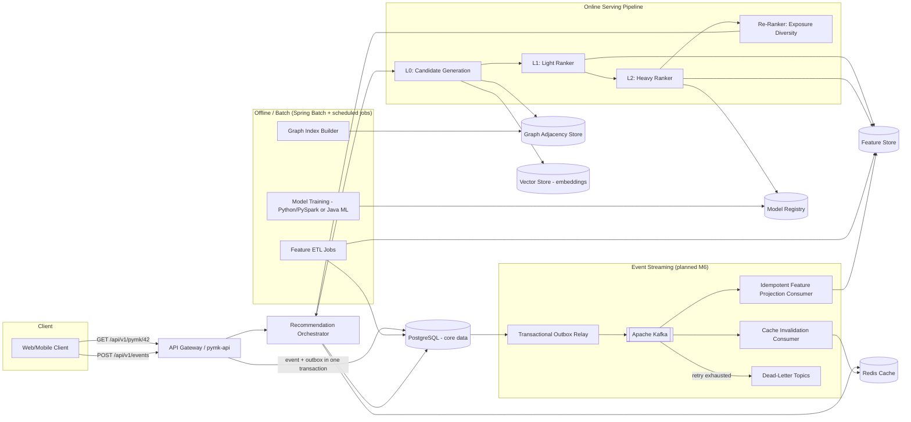
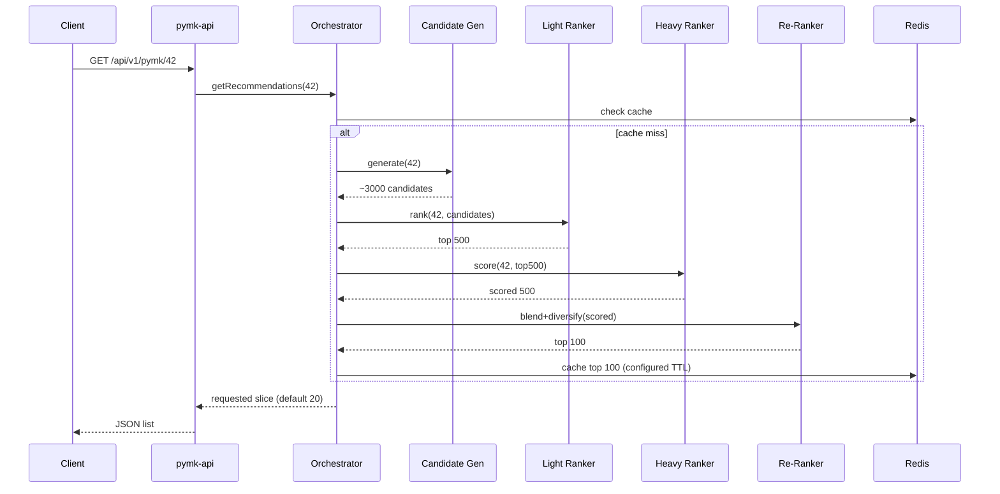

# People You May Know (PYMK) — Backend System Design

A portfolio-scale reimplementation of LinkedIn-style "People You May Know" recommendations, built on the Java ecosystem (Spring Boot, Spring Data JPA), following the multi-stage funnel architecture described in LinkedIn's PYMK engineering blog.

---

## 1. Goals & Scope

**Functional goals**
- Given a member, recommend a ranked list of other members they are likely to connect with.
- Support explicit signals (mutual connections, shared company/school, location) and implicit signals (profile views, search appearances).
- Capture member activity through a durable Kafka event backbone so fresh behavioral signals can update feature projections without coupling request handling to downstream consumers.
- Provide an exposure-diversity pass so results are not dominated by a single cluster (e.g. all coworkers), while avoiding unsupported claims of protected-attribute fairness.
- Serve recommendations with low latency (<150ms p99 target for demo scale).

**Non-functional / portfolio goals**
- Demonstrate a realistic **multi-stage ranking pipeline** (candidate generation → light ranking → heavy ranking → re-ranking), scaled down from "billions of members" to a dataset of ~100K–1M synthetic members, so it runs on a laptop / a single cheap cloud VM but the architecture generalizes.
- Clean separation of concerns so each stage could later be extracted into its own microservice.
- Show both the "traditional Spring backend" skills (JPA, REST, caching, batch jobs) and applied ML engineering (feature engineering, model training/serving, offline evaluation).

**Out of scope (documented, not built)**
- True graph-database-scale traversal (v1 uses a graph adjacency table in Postgres; Neo4j or adjacency shards are upgrade paths, not current modules).
- Authentication, authorization, and abuse controls. The portfolio API is local/demo infrastructure and must not be exposed publicly without them.

### 1.1 Document status and implementation boundary

This document is the **target design**, not a claim that every box already
exists. The roadmap is the delivery authority when design and implementation
status differ.

| Area | Current status |
|---|---|
| Maven modules, Postgres/pgvector/Redis local infrastructure | Implemented through Day 1 |
| Core entities, Flyway schema, repositories, symmetric connection service | Implemented through Day 3 |
| Synthetic members, graph, temporally valid events, placeholder embeddings | Implemented through Day 5 |
| Member lookup, connection creation, Problem Details, OpenAPI, smoke status | Implemented through Day 6 |
| Foundation audit and documented data-model/seeding runbook | Implemented on Day 7 |
| Candidate contract, heuristic source, shared eligibility policy | Implemented on Day 8 |
| Cycle-safe graph-walk and pgvector embedding candidate sources | Implemented on Day 9 |
| Bounded parallel L0 union, provenance merge, budgets/global cap | Implemented on Day 10 |
| Naive mutual-connection orchestrator and public PYMK endpoint | Implemented on Day 11 |
| Versioned L0/final Redis caches and graph-mutation invalidation | Implemented on Day 12 |
| End-to-end recommendation relevance and safety QA | Implemented on Day 13 |
| M2 naive-v1 release contract and runnable documentation | Completed on Day 14 |
| Directional pair-feature schema, entity, repository, and snapshot contract | Implemented on Day 15 |
| Snapshot-safe pair-feature computation | Implemented on Day 16 |
| Restartable Spring Batch feature materialization | Implemented on Day 17 |
| Label generation, rankers, and re-ranker | Planned for Days 18+ |
| Kafka event backbone, transactional outbox, and streaming projections | Planned for Days 31–35 (M6) |

The current checkpoint is **Day 17 complete**. Target-only sections below use
future tense where practical; see `PYMK_ROADMAP.md` for acceptance criteria.

---

## 2. High-Level Architecture



Each ranking stage will be implemented behind a well-defined Java interface and
run in-process for v1. A later service extraction can replace an implementation
with REST/gRPC without changing the orchestrator's domain contract. Module
boundaries are architectural seams, not a requirement to deploy every module as
a separate microservice.

---

## 3. Tech Stack

| Layer | Choice | Notes |
|---|---|---|
| Language / Framework | Java 21, Spring Boot 3.x | LTS Java, virtual threads for I/O-bound fan-out calls |
| Persistence | Spring Data JPA + PostgreSQL | Core member/connection/event data |
| Caching | Spring Data Redis | Cache L0 candidate sets and final PYMK lists (TTL) |
| Batch / ETL | Spring Batch | Nightly feature computation, model refresh jobs |
| Async / messaging (planned M6) | Apache Kafka + Spring Kafka | Durable member/connection events, streaming feature projections, and cache invalidation |
| Graph traversal | Postgres recursive CTE (v1) → Neo4j (v2, optional module) | n-hop neighbor candidate generation |
| Vector similarity | pgvector extension on Postgres | Embedding-based retrieval (EBR) candidate source |
| ML training | Python (scikit-learn/XGBoost) exported to **ONNX** or **PMML**, served from Java via ONNX Runtime / JPMML-Evaluator | Keeps training in the best ecosystem for it, keeps serving in Java |
| ML alternative (pure Java) | Tribuo (Oracle's Java ML library) or Smile | For a "100% Java" version if avoiding Python entirely is a hard requirement |
| API | Spring Web (REST), OpenAPI/Swagger | `pymk-api` module |
| Testing | JUnit5, Testcontainers (Postgres/Redis), Mockito | |
| Build | Maven multi-module | One parent reactor, Java 21 toolchain |
| Deployment | Docker Compose (local), optional Kubernetes manifests | |
| Observability | Micrometer + Prometheus + Grafana | Latency/throughput per stage |

---

## 4. Repository / Module Layout

```
pymk/
├── pymk-common/            # shared DTOs, enums, utils
├── pymk-domain/             # JPA entities, repositories
├── pymk-feature-store/      # feature computation + read/write API
├── pymk-candidate-gen/      # L0: graph, EBR, heuristic candidate sources
├── pymk-light-ranker/       # L1: logistic regression / GBDT scoring
├── pymk-heavy-ranker/       # L2: DNN model serving via ONNX Runtime
├── pymk-reranker/           # exposure diversity, Bayesian-optimized blending
├── pymk-orchestrator/       # wires stages together, exposes internal service API
├── pymk-api/                # public REST controllers, request/response DTOs
├── pymk-batch/               # Spring Batch jobs: ETL, model refresh, graph index build
├── pymk-event-stream/        # Kafka contracts, outbox relay, consumers, retries, and projections (planned M6)
├── pymk-datagen/             # one-off synthetic dataset generator for local development
├── pymk-ml-training/         # Python project (offline), exports model artifacts
├── infra/                    # docker-compose.yml, k8s manifests, init SQL
└── docs/
    └── PYMK_DESIGN.md (this file)
```

---

## 5. Data Model (Spring Data JPA)

### 5.1 Implemented and planned entities

`Member`, `Connection`, `MemberEvent`, `MemberEmbedding`, and
`PymkPairFeature` are implemented.

```java
@Entity
@Table(name = "members")
public class Member {
    @Id
    private Long id;
    private String fullName;
    private String headline;
    private String company;
    private String school;
    private String geoRegion;
    private Instant createdAt;
    // profile completeness, industry, etc.
}

@Entity
@Table(name = "connections", indexes = {
    @Index(name = "idx_conn_member", columnList = "member_id"),
    @Index(name = "idx_conn_connected", columnList = "connected_member_id")
})
public class Connection {
    @Id @GeneratedValue
    private Long id;
    private Long memberId;
    private Long connectedMemberId;
    private Instant connectedAt;
    // undirected edge, stored as two rows (memberId<->connectedMemberId) for O(1) adjacency lookups
}

@Entity
@Table(name = "member_events")
public class MemberEvent {
    @Id @GeneratedValue
    private Long id;
    private Long actorMemberId;
    private Long targetMemberId;
    @Enumerated(EnumType.STRING)
    private EventType type; // PROFILE_VIEW, SEARCH_APPEARANCE, INVITE_SENT, INVITE_ACCEPTED, INVITE_IGNORED
    private Instant occurredAt;
}

@Entity
@Table(name = "member_embeddings")
public class MemberEmbedding {
    @Id
    private Long memberId;
    @Column(columnDefinition = "vector(128)") // pgvector
    private float[] embedding;
    private Instant updatedAt;
}

@Entity
@Table(name = "pymk_features")
public class PymkPairFeature {
    @EmbeddedId
    private PairId id; // (memberId, candidateId)
    private int mutualConnectionCount;
    private boolean sameCompany;
    private boolean sameSchool;
    private boolean sameGeo;
    private double embeddingCosineSim;
    private int profileViewCountLast30d;
    private Instant featureAsOf; // latest source data included; leakage boundary
    private Instant computedAt;
}
```

### 5.2 Schema notes
- `connections` is denormalized as a symmetric edge list — trades storage for O(1) adjacency queries, matching how LinkedIn's graph-based candidate generation needs fast n-hop lookups.
- `member_embeddings` uses **pgvector** so L0's embedding-based retrieval (EBR) source can do an ANN (`<=>` cosine distance) query directly in Postgres without a separate vector DB for portfolio scale. Documented upgrade path: Qdrant/Milvus for production scale.
- `pymk_features` is the **feature store** table: precomputed member-candidate pair features refreshed by the nightly Spring Batch ETL job, read by L1/L2 rankers at serving time (avoids expensive joins in the hot path).

### 5.3 Data invariants

- A connection is one logical undirected edge stored as `(A,B)` and `(B,A)` in one transaction. The database enforces foreign keys, no self-edge, and uniqueness per direction; `ConnectionService` owns the two-row invariant.
- Connection writes use canonical member order internally so simultaneous `(A,B)` and `(B,A)` requests acquire keys consistently rather than deadlocking.
- API connection creation is idempotent: new edges return `201`, complete existing edges return `200`, and a unique-constraint race returns retryable `409`.
- Synthetic connections and events never predate either involved member and never occur after the generator's reference time.
- Embedding retrieval uses cosine distance (`<=>`) with the matching `vector_cosine_ops` HNSW index. `<->` is Euclidean distance and is not interchangeable at the query/index level.
- `pymk_features` keys are directional because member-to-candidate activity can differ from candidate-to-member activity. Both IDs must exist and differ.
- `feature_as_of` is the latest source-data time included in a row; `computed_at` is when it was materialized. The database enforces `feature_as_of <= computed_at` so feature snapshots cannot claim future knowledge.
- Day 16 feature computation counts mutual edges only when both directed edges existed by `feature_as_of`, and counts requester-to-candidate profile views in `(feature_as_of - 30 days, feature_as_of]`. Reverse views, the exclusive lower boundary, and later events are excluded.
- Embeddings are used only when both `updated_at` values are no later than the snapshot; otherwise cosine similarity is the neutral value `0`. Zero vectors also map to `0`, while malformed/non-finite vectors fail fast.
- Company, school, and geo flags require the same nonblank canonical value. The current synthetic model treats these member attributes as stable; historical profile-version storage is required before mutable production profiles can be backfilled without leakage.

---

## 6. The Multi-Stage Ranking Pipeline

This mirrors the LinkedIn blog's four stages directly.

### Stage L0 — Candidate Generation
**Goal:** reduce full member pool (v1 scale: up to 1M) down to a few thousand candidates. Optimize for **Recall@k**, not precision.

The `CandidateSource` contract, all three source implementations, and their L0
union are complete as of Day 10. Sources return provenance rather than bare IDs
so L1 calibration, debugging, and the explanation endpoint can distinguish why
a member entered the funnel:

```java
public record CandidateHit(
        long candidateId,
        CandidateSourceType source,
        double sourceScore,
        Map<String, String> metadata) {}

public interface CandidateSource {
    CandidateSourceType type();
    List<CandidateHit> generate(long memberId, int limit);
}
```

- `GraphWalkCandidateSource` — **implemented**; a recursive CTE fetches shortest simple 2/3-hop paths, prevents path cycles, counts equally short paths, and prioritizes closer candidates with more paths.
- `EmbeddingRetrievalCandidateSource` — **implemented**; pgvector cosine retrieval against `member_embeddings`, with cosine similarity as its source-local score.
- `HeuristicCandidateSource` — **implemented**; exact company/school/geo matches, scored by the fraction of the requester's available profile attributes that match. Results are ordered by match strength and then member ID for deterministic limits.

Every source applies the shared eligibility policy, which excludes the requesting
member, existing first-degree connections, duplicate hits within that source,
and member IDs that no longer exist. `L0CandidateGenerator` runs sources on
virtual threads behind a configurable concurrency semaphore, enforces source
budgets even if a source violates its contract, and caps the default union at
3,000 candidates. It de-duplicates across sources while retaining every source
hit and orders the union with reciprocal-rank fusion rather than comparing
uncalibrated source scores. A source failure cancels the remaining fan-out and
fails the generation request; partial candidate sets are not silently served.

### Day 11 baseline orchestration

`RecommendationOrchestrator` is the first end-to-end serving implementation.
It checks that the requester exists, generates the complete L0 union, fetches
mutual-connection counts for all candidates in one query, and orders by mutual
count descending. Day 10's fusion score and candidate ID provide deterministic
tie-breakers. The public limit defaults to 20 and is capped at 100. Candidate
source failures become retryable `503` Problem Details instead of an empty or
partially generated list. This mutual-count value is the temporary public
`score`; L1 replaces it with a calibrated score later in the roadmap.

### Stage L1 — Light Ranker
**Goal:** narrow a few thousand candidates to a few hundred. Calibrate scores across the heterogeneous L0 sources so they're comparable. Evaluated by **Recall@k** at k≈500.

- Lightweight model: logistic regression or XGBoost, trained offline on features from `pymk_features`.
- Served in Java via **JPMML-Evaluator** (XGBoost/LogReg exported as PMML) or **ONNX Runtime for Java**.
- Pure-Java fallback: implement logistic regression scoring manually (it's just a dot product + sigmoid) if avoiding external runtime dependencies — trivial and fast enough for this stage.

### Stage L2 — Heavy Ranker
**Goal:** precisely rank the few hundred remaining candidates. Evaluated by **AUC / Precision@k / ECE** (calibration matters because these scores feed the re-ranker).

- Deep model (small feed-forward NN) trained offline in Python, exported to **ONNX**, served via **ONNX Runtime Java API** inside `pymk-heavy-ranker`.
- Predicts multiple engagement events per candidate pair: `P(invite_sent)`, `P(invite_accepted)`.
- Batches all candidates for one member into a single ONNX inference call for efficiency.

### Stage Re-Ranker
**Goal:** final blending + exposure-diversity constraints, producing the top-N (e.g. 20) shown to the user.

- Combines L2's multiple predicted probabilities via a weighted linear blend: `score = w1*P(sent) + w2*P(accepted) + ...`
- Weights `w1, w2...` are tuned offline via **Bayesian optimization** (e.g. a small Python job using `scikit-optimize`, replayed against a held-out logged dataset), then loaded as configuration into `pymk-reranker`.
- **Exposure-diversity pass:** cap the proportion of results from any single dominant cluster (e.g. no more than 40% from the same employer) using a deterministic constrained re-sort. This improves result diversity but is not, by itself, a protected-attribute fairness guarantee; any fairness claim requires explicit groups, metrics, and evaluation.

### Orchestration flow



### Cache correctness

- **Implemented on Day 12:** L0 and final-result keys include schema, pipeline, and model versions so deployments do not serve structurally stale values.
- L0 defaults to a 30-minute TTL and the final top-100 result to 15 minutes. The API slices that reusable result to the requested 1–100 limit.
- Successful connection mutations invalidate both layers after commit for both endpoints and their two-hop neighborhoods; this covers requesters whose at-most-three-hop candidate paths can change. TTL remains a consistency backstop.
- Cache reads, writes, corrupt payloads, and invalidation failures degrade to the underlying pipeline instead of failing recommendation requests.
- Cached payloads are JSON representations of immutable candidate/recommendation contracts, never JPA entities.

---

## 7. Offline Pipeline (Spring Batch)

| Job | Frequency | Purpose |
|---|---|---|
| `FeatureComputationJob` | nightly | **Implemented Day 17:** recompute `pymk_features` for bounded, snapshot-eligible member pairs |
| `EmbeddingRefreshJob` | weekly | Recompute member embeddings (e.g. node2vec-style over the connection graph, or a simple profile-text embedding) |
| `GraphIndexRebuildJob` | daily | Materialize/refresh any denormalized adjacency structures used by L0 |
| `ModelSyncJob` | on model release | Pull latest ONNX/PMML model artifact from the model registry (could just be a versioned S3/local path for a portfolio project) into `pymk-heavy-ranker` / `pymk-light-ranker` |
| `OfflineEvalJob` | weekly | Compute Recall@k / AUC / Precision@k against a held-out labeled set, log to a metrics table for a "model quality over time" dashboard |

`FeatureComputationJob` requires an ISO-8601 `featureAsOf` job parameter and
records `computedAt` from its own UTC clock. Future snapshots are rejected. Its
restartable cursor reads only members created by the snapshot. For each member,
bounded two/three-hop graph,
exact profile, and pgvector sources form a deterministic candidate union using
only connections, members, and embeddings available at the snapshot; self,
already-connected, future, and duplicate candidates are excluded before the
global cap.

The preflight step rejects a snapshot older than the newest materialized one.
The computation step uses conditional PostgreSQL upserts that cannot overwrite
a newer pair row, and the final step deletes rows older than the completed
snapshot. A failed computation therefore leaves the previous good snapshot
available. Spring Batch execution and restart state lives in Flyway V4 metadata
tables. Reusing all identifying parameters
restarts a failed instance or refuses an already-completed instance; an explicit
`run.id` creates an intentional rerun. Chunk size, cursor fetch size, per-source
candidate limits, and the global cap are configurable under
`pymk.batch.feature-computation`.

### 7.1 Kafka event pipeline (planned M6)

Kafka complements the offline jobs; it does not replace PostgreSQL or the
nightly, reproducible feature snapshot. PostgreSQL remains the source of truth,
while Kafka distributes committed changes to independently scalable consumers.

`POST /api/v1/events` will validate an event and atomically insert both the
canonical `member_events` row and an outbox row in PostgreSQL. A relay publishes
the outbox record to Kafka and marks it published only after broker
acknowledgement. This avoids the failure window created by writing to the
database and Kafka separately. The endpoint returns `202 Accepted` after the
database transaction commits; downstream projections are eventually
consistent.

Initial topics and ownership:

| Topic | Key | Producers | Consumers |
|---|---|---|---|
| `pymk.member-events.v1` | subject member ID | Outbox relay | Pair-feature projection, analytics |
| `pymk.connection-events.v1` | canonical connection-pair key | Outbox relay | Graph projection, cache invalidation |
| `pymk.member-events.dlt.v1` | original record key | Retry recoverer | Operations/replay tooling |
| `pymk.connection-events.dlt.v1` | original record key | Retry recoverer | Operations/replay tooling |

The versioned JSON event envelope contains `eventId`, `schemaVersion`,
`eventType`, `occurredAt`, `ingestedAt`, `subjectMemberId`, optional
`targetMemberId`, `correlationId`, and a type-specific payload. JSON Schema is
kept with the producer and compatibility-tested in the reactor; incompatible
changes require a new topic version.

Delivery is deliberately **at least once**. Consumers commit Kafka offsets only
after their database transaction succeeds and use `eventId` as an idempotency
key. Processing uses bounded retries with exponential backoff; exhausted records
go to the matching dead-letter topic with the original metadata and failure
reason. Partition keys preserve ordering for one subject, but no global event
ordering is assumed. Consumers reject stale events when applying a projection
whose recorded event time is newer.

Streaming projections maintain recent counters such as profile views and issue
targeted cache invalidations. Nightly `FeatureComputationJob` output remains the
repair/reconciliation path, so replaying a topic or recovering from consumer
downtime cannot permanently drift the feature store. Metrics cover outbox lag,
consumer lag, publish/consume rates, retries, dead-letter counts, processing
latency, and projection freshness.

---

## 8. API Design

```
GET  /                                                   # smoke status (implemented)
GET  /actuator/health                                    # dependency-aware health (implemented)
GET  /api/v1/members/{id}                                # implemented
POST /api/v1/connections                                 # implemented graph mutation
GET  /api/v1/pymk/{memberId}?limit=20
GET  /api/v1/pymk/{memberId}/explain/{candidateId}   # returns feature breakdown, for demo/debugging
POST /api/v1/events                                   # planned M6: durably accept an event and return 202
```

API conventions:

- IDs and limits must be positive; malformed or semantically invalid input returns `400`.
- Missing members return `404`; concurrent uniqueness races return `409`.
- Errors use RFC 9457 `application/problem+json` with a stable type URI and useful extensions.
- `POST /connections` mutates the graph only at the current checkpoint. Event ingestion remains a separate planned M6 endpoint, avoiding an undocumented synthetic `INVITE_ACCEPTED` event.
- List endpoints enforce server-side maximum limits even when the client asks for more.

### 8.1 Recommendation quality gate

The Day 13 end-to-end gate exercises the public recommendation endpoint against
real PostgreSQL/pgvector and Redis containers. Across several synthetic member
IDs and limits from 1 through 100 it asserts that results never include the
requester, an existing connection, a duplicate, or a missing member, and never
exceed the requested limit. It also locks in deterministic cached responses,
mutual-count ordering, and human-readable reasons. The companion PowerShell
smoke script applies the response-visible checks to selected IDs in a running
seeded environment; database-backed automated tests remain the authority for
the existing-connection invariant.

`GET /api/v1/pymk/{memberId}` response:
```json
{
  "memberId": 42,
  "recommendations": [
    {
      "candidateId": 981,
      "score": 12.0,
      "mutualConnectionCount": 12,
      "reasons": ["12 mutual connections", "Same company: Acme Corp"]
    }
  ]
}
```

---

## 9. Offline vs. Online Evaluation

Following the blog directly:
- **L0/L1** → offline metric: **Recall@k**.
- **L2** → offline metrics: **AUC**, **Precision@k**, **ECE** (calibration).
- **Re-Ranker** → diversity metrics (e.g. cluster entropy of results) + simulated log-likelihood.
- **End-to-end** → since this is a portfolio project without real users, run a replay evaluation on a held-out future time window, comparing the multi-stage pipeline against a mutual-connections baseline.

All features must be computed as of a snapshot time, with labels taken only
from a later window. Random row splits or features computed after an invite was
accepted would leak the outcome and make reported lift meaningless. Synthetic
results are labeled as offline replay metrics, not presented as a real online
A/B test or production CTR lift.

---

## 10. Scalability Notes (documented, not all built for v1)

- L0's graph CTE approach is intended for the portfolio-scale dataset; its actual ceiling must be demonstrated with load tests rather than asserted from member count alone. A dedicated graph store or in-memory adjacency shards are later options.
- Candidate/result caching in Redis keeps p99 latency low for repeat requests; cold-start requests pay the full pipeline cost once.
- Each stage is stateless and horizontally scalable if split into its own service — the module boundaries in section 4 are drawn specifically so that split is mechanical, not a redesign.
- Feature store table can be swapped for a real feature store (Feast) without changing the ranker interfaces.
- Kafka is not on the synchronous recommendation read path. Broker or consumer downtime can delay freshness but must not make `GET /api/v1/pymk/{memberId}` unavailable; the outbox and nightly reconciliation job provide recovery paths.

---

## 11. Suggested Build Order (Milestones)

1. **M1 — Core domain and API foundation**: entities, Postgres schema, seed data generator, member lookup, connection mutation, OpenAPI, error contract, and local runbook. **Complete through Day 7.**
2. **M2 — Naive PYMK**: heuristic, graph, and embedding L0 sources with provenance and eligibility filtering; mutual-connection ordering straight to the API; versioned Redis caching and mutation invalidation; end-to-end relevance and safety QA; runnable release documentation. **Complete through Day 14.**
3. **M3 — Feature store + L1**: directional persistence, snapshot-safe computation, and restartable batch materialization are complete through Day 17; label generation, model training, and light-ranker serving follow.
4. **M4 — L2 heavy ranker**: train offline model, export ONNX, serve via `pymk-heavy-ranker`.
5. **M5 — Re-ranker**: blending + exposure diversification.
6. **M6 — Kafka event backbone**: versioned event contracts, transactional outbox publishing, idempotent consumers, streaming feature projections, retries/dead-letter handling, and end-to-end Testcontainers coverage.
7. **M7 — Batch operations**: scheduling, restartability, idempotency, reconciliation, and remaining production-style batch jobs.
8. **M8 — Observability + offline eval dashboard**: Micrometer/Grafana, Kafka/outbox/consumer-lag telemetry, and Recall@k tracking over time.
9. **M9 — Polish for portfolio**: one-command Docker Compose startup including Kafka, architecture/runbook documentation, load-test evidence, sample requests, and a reproducible offline evaluation report.

---

## 12. Attribution

Architecture pattern (multi-stage funnel: L0 candidate generation → L1 light ranking → L2 heavy ranking → re-ranking) adapted from LinkedIn Engineering's public writeup on the "People You May Know" recommendation system. This document reinterprets that pattern as a Java/Spring Boot implementation at a portfolio-appropriate scale; it is an original design, not a reproduction of LinkedIn's internal system or text.
